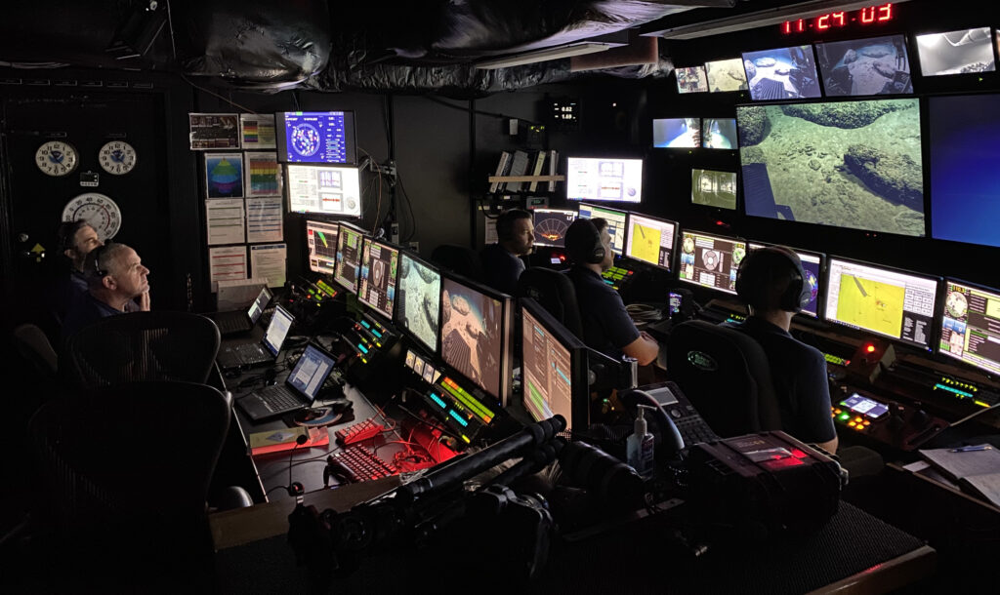

# Submarine ROV Club and Our Vision for Helping the Museum

*Club journal — October 26, 2026*

## Why we build

The Submarine ROV club is a place to learn engineering by developing an underwater robot together. ROV stands for remotely operated vehicle: a vehicle controlled by an operator from outside it. Our project gives us a practical reason to connect mechanical design, electronics, programming, and testing. Each part has to work with the others. A propeller needs room to turn, a motor needs a secure mount, and the person operating the vehicle needs predictable control. Our larger vision is to use what we learn to help the museum share science and exploration with its community.

That purpose gives the project direction. We want to make something useful and understand it well enough to explain how it works. The interesting part of an underwater robot is the chain of decisions behind it: why a motor faces one way, how a component can be removed for repair, or what a test actually tells us. Those decisions give the club a shared problem to work on. They also give us material that could eventually help someone else see engineering as something they can take part in.

**Real-world example — underwater exploration.** NOAA’s Deep Discoverer shows how an ROV can bring observation tools underwater. It is a professional research vehicle, separate from our club project. Photo: NOAA; public domain, via the [U.S. Fish & Wildlife Service](https://www.fws.gov/media/rov-deep-discoverer).

## What our design looks like

As of today, our clearest progress is in design and preparation for fabrication. The project includes CAD models, printable parts, frame cutting files, assembly instructions, and records of geometry checks. CAD means computer-aided design. It lets us inspect how parts fit together before committing material to a full build. These records describe a vehicle under development. Physical fit, reliable operation in water, and the ability to carry out a useful task still need to be demonstrated through testing.

The vehicle layout uses eight thruster positions. Four have horizontal shafts set diagonally, and four have vertical shafts. A thruster is the motor and propeller unit that produces force to move the vehicle. Arranging several units around a frame creates the possibility of controlling movement in different directions, but the arrangement is only one part of the problem. The motors, electronic controls, software, and actual thrust all have to work together. Our [eight-thruster layout notes](../../cad/eight-thruster-assembly-2026-10-17/READ-ME.txt) record the modeled positions and clearances without claiming that the complete vehicle has already been driven in water.

**Project design — eight-thruster layout, October 17.** This CAD view makes the arrangement described above visible. It records the modeled layout; it is not a photograph of a tested vehicle.

The frame work shows how our design has developed. An early chassis established the arrangement of the holders and the surrounding structure. A later assembly explored a frame made from aluminum panels with space for an electronics tube. The October 18 revision reduced that frame from eight panels to five and reduced the frame joint bolts from twenty-four to eight. It also gave the tube a clear upward removal path in the model. The [simplified assembly notes](../../cad/easy-assembly-2026-10-18/READ-ME.txt) explain those changes and their remaining physical checks. Making the vehicle easier to assemble and reach inside is a practical goal: we will need to inspect, adjust, and repair it as we learn.

**Project design — simplified assembly, October 18.** The open frame and tube straps show the intended access for assembly and maintenance. Tube protection and the full vehicle still require physical validation.

**Design graph — fewer frame parts and joints.** Both pairs use the same zero-based count scale. Values come from the [October 18 assembly notes](../../cad/easy-assembly-2026-10-18/READ-ME.txt); they measure design simplification, not strength or assembly time.

Much of the recent work has focused on a single thruster assembly. Its housing, motor attachment, fan, and removable cone have gone through several revisions. The October 25 smooth-frame revision removed obsolete crescent mounts and smoothed the outside of the housing while retaining the current working joints. The [assembly and print guide](../../cad/smooth-frame-r14-2026-10-25/ASSEMBLY-AND-PRINT.txt) includes small test pieces so that important fits can be checked before printing a complete replacement. The design checks support the shape and assembly clearances in the model; they do not establish real thrust, strength, or underwater durability. Earlier whole-vehicle snapshots also remain separate from these newer thruster revisions, so bringing the parts together is still an integration task.

**Project design — a closer look at one thruster.** The R14 model connects the discussion of housing, propeller, and removable cone to an actual saved design. This newer component revision still needs integration with the earlier whole-vehicle layout.

This kind of work is what the club does in concrete terms: take a design problem, inspect it closely, make a change, and record what that change establishes. Sometimes progress is a new part. Sometimes it is a simpler assembly or a better explanation of a limit. Removing a feature that no longer serves a purpose can be just as useful as adding one. Keeping a record helps us understand why a shape changed and prevents the next person from having to reconstruct the entire decision from a finished model.

## Bringing engineering into the museum

Our vision for helping the museum starts with education. We would like the project to make engineering and underwater exploration easier for visitors to understand. A robot can give a visitor something specific to ask about: how it moves, what the operator can see, why the electronics need protection, or how the team knows a part fits. Those questions can lead into science through a real object and the work behind it. The museum would guide which topics and formats suit its visitors and programs.

One possible first contribution is a small display about the design process. CAD images, a few unpowered printed components, and an explanation of how the parts connect could show the progression from an idea to a usable assembly. A visitor could compare an earlier housing with a revised one and see why access to a screw or clearance around a propeller matters. We could explain an actual decision from our own records instead of presenting only a finished object. Such a display would give the club a way to share useful work while the complete vehicle is still being developed.

Another possibility is an activity built around a question the robot raises. Visitors might predict how a change in thruster placement would affect movement, or think through how a part could be replaced without taking the whole vehicle apart. The activity would need to fit the museum's audience, available space, and supervision. Our contribution could include clear diagrams, demonstration parts, and explanations that staff can use again. The goal would be to let visitors reason through a problem and compare their ideas with the choices made in the project.

**Museum concept — see, compare, and ask.** A possible visitor experience built around the activities described above. This diagram is a discussion aid; the museum would determine the audience, format, space, and supervision.

## A future window underwater

In the longer term, we hope a working ROV could help the museum explore or document something underwater. That possibility depends on a real need identified by museum staff and on a vehicle whose capabilities have been demonstrated. For example, if useful to the museum, a future camera system might support a supervised viewing or documentation task. Camera capability is a future possibility here, and it would need its own design and testing. The work should begin with what the museum wants to learn or show, then determine whether our vehicle is an appropriate tool for that task.

**Real-world example — people behind the robot.** This NOAA control-room photograph illustrates the link between an underwater vehicle, its operators, and the images they observe. It offers context for our future viewing idea; our club has not demonstrated this camera capability. Image courtesy of NOAA Ocean Exploration, [2022 ROV and Mapping Shakedown](https://oceanexplorer.noaa.gov/multimedia/okeanos-explorations-ex2201-gallery-media-control-room/).

Helping the museum also means making our contribution manageable for the people who would use it. A demonstration needs an understandable setup, a clear explanation, and someone able to answer questions about its limits. A technical project needs maintenance information and records that remain useful after a particular meeting or revision. We want the club's documentation to support that continuity. The same care that helps us find the correct print file or assemble a joint could help museum staff understand what a proposed activity requires.

## Turning the vision into evidence

The next part of our work is to connect the model to physical evidence. Small fit pieces can reveal whether real nuts, washers, and printed surfaces behave as expected. Assembly checks can show whether the motor and propeller move freely and whether parts can be installed in the intended order. Controls and power systems then need their own checks before a complete vehicle can be evaluated in water. The existing [physical fit record](../../cad/thruster-final-optimization/physical-fit-record.csv) includes tests marked as not yet performed. Completing records like that will help us decide what we can confidently demonstrate and what still needs work.

**Development roadmap — evidence before demonstration.** The design records are our present starting point. Later stages describe work still to be completed, with design changes whenever tests reveal a problem. A small unpowered display could begin earlier, using the evidence already available.

For the club, success means developing both a capable vehicle and the ability to explain the work behind it. We want to be able to show what changed, describe why it changed, and point to the observations that support our conclusions. For the museum, success would mean a contribution that serves an actual educational or practical need. The scale could begin with a simple display and grow as the project becomes more capable. The connection between those goals is what makes the work worth continuing: learning carefully enough that what we build can become useful to other people.
