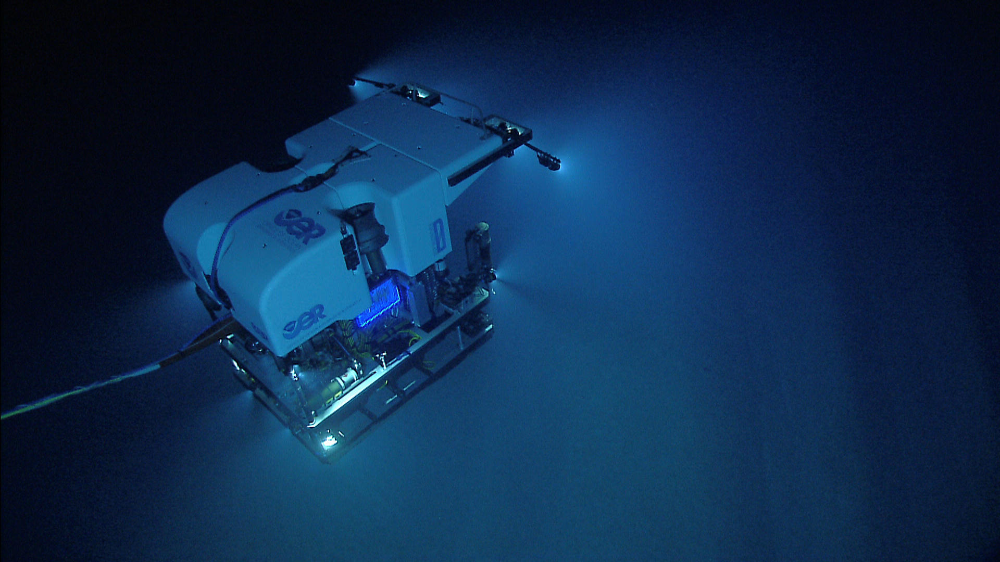
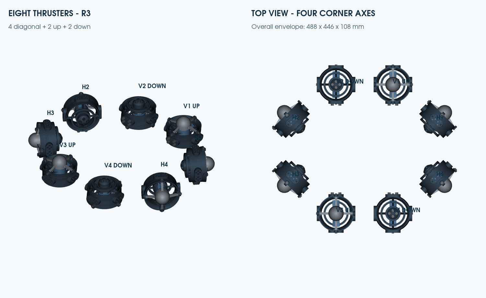
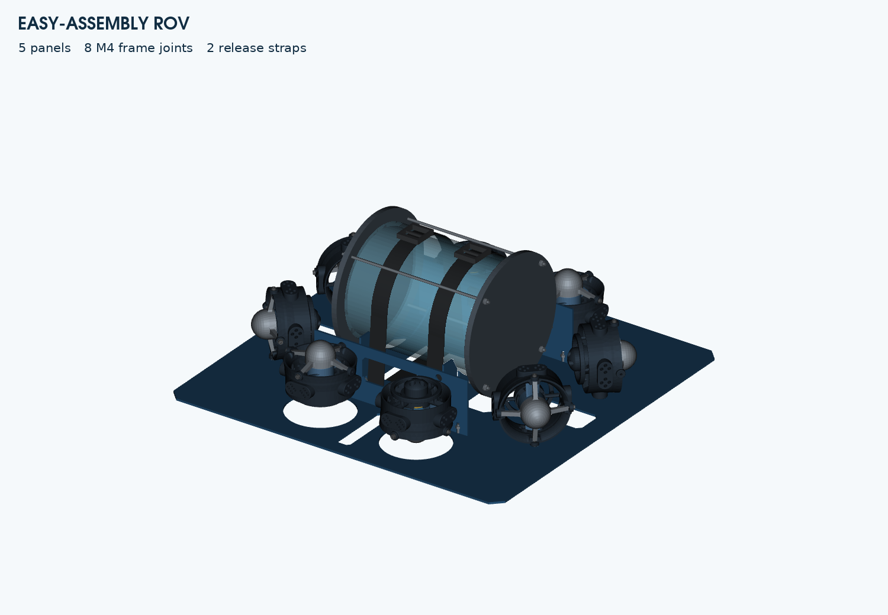
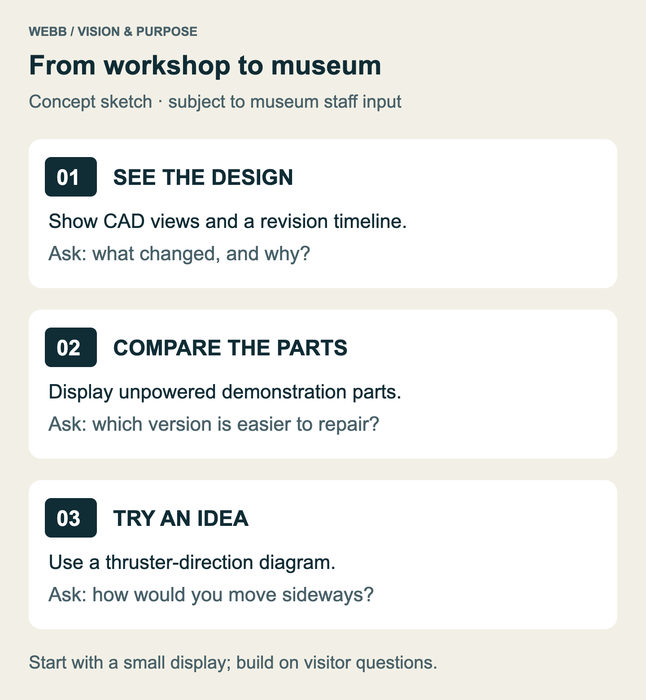
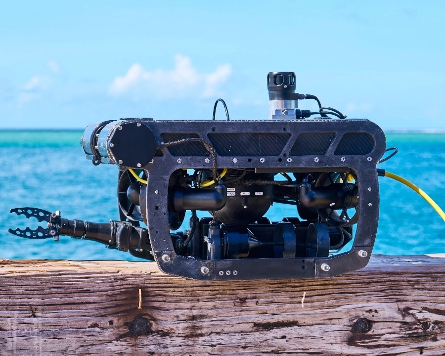
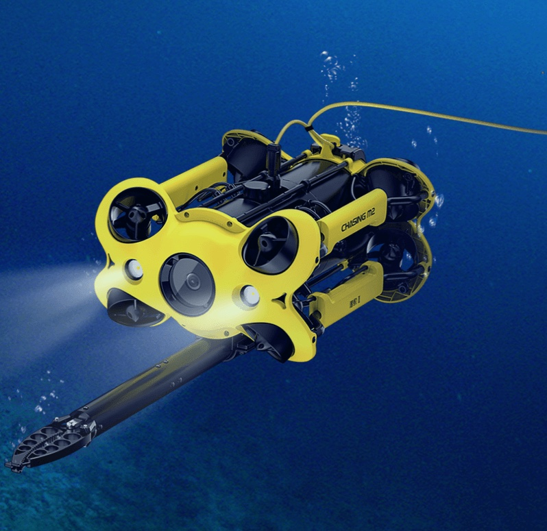
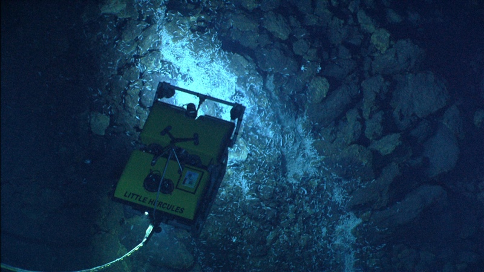
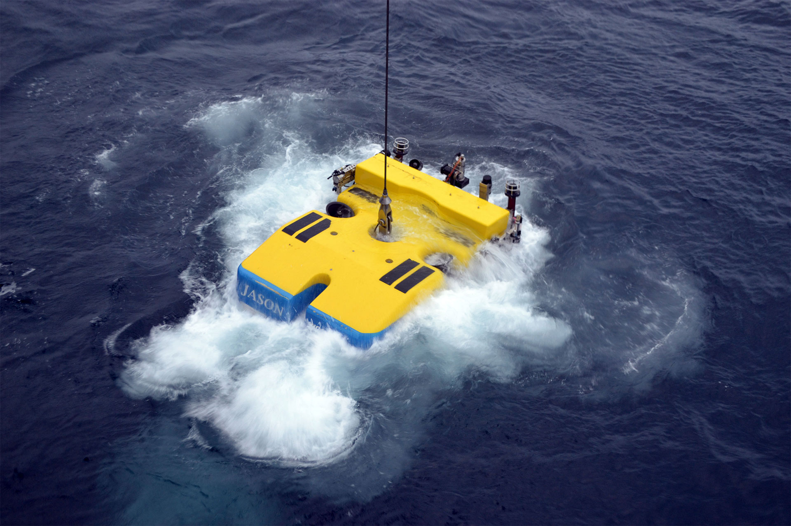
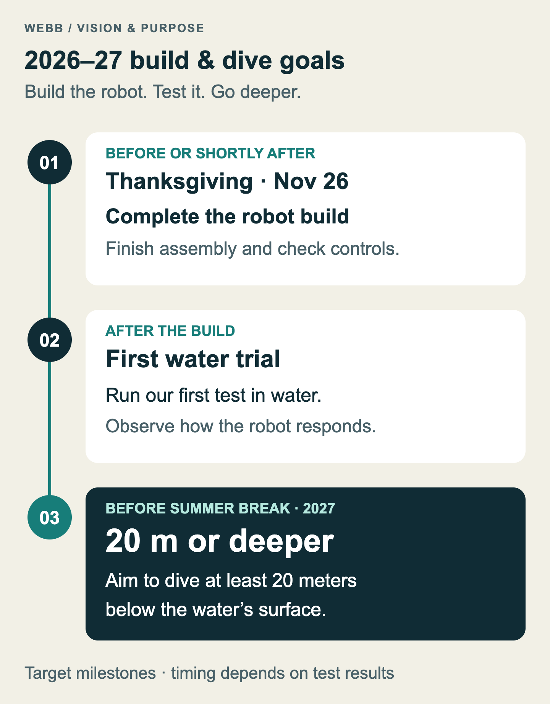

# Submarine ROV Club and Our Vision for Helping the Museum

*Club journal — October 26, 2026*

## Why we build

We learn engineering by building an underwater robot together. Our remotely operated vehicle (ROV) brings mechanical design, electronics, programming, and testing into one project.

Our goal is to help the museum find fossils in oceans, lakes, and other underwater environments. We are developing an ROV with planned lights, cameras, and a robotic arm to support fossil searches and share discoveries with the museum’s community.

**Real-world example — underwater exploration.** NOAA’s Deep Discoverer shows how an ROV can bring observation tools underwater. It is a professional research vehicle, separate from our club project. Photo: NOAA; public domain, via the [U.S. Fish & Wildlife Service](https://www.fws.gov/media/rov-deep-discoverer).

## What our design looks like

As of today, our clearest progress is in design and preparation for fabrication. The project includes CAD models, printable parts, frame cutting files, assembly instructions, and records of geometry checks. CAD means computer-aided design. It lets us inspect how parts fit together before committing material to a full build. These records describe a vehicle under development. Physical fit, reliable operation in water, and the ability to carry out a useful task still need to be demonstrated through testing.

The vehicle layout uses eight thruster positions. Four have horizontal shafts set diagonally, and four have vertical shafts. A thruster is the motor and propeller unit that produces force to move the vehicle. Arranging several units around a frame creates the possibility of controlling movement in different directions, but the arrangement is only one part of the problem. The motors, electronic controls, software, and actual thrust all have to work together. Our [eight-thruster layout notes](../../cad/eight-thruster-assembly-2026-10-17/READ-ME.txt) record the modeled positions and clearances without claiming that the complete vehicle has already been driven in water.

**Project design — eight-thruster layout, October 17.** This CAD view makes the arrangement described above visible. It records the modeled layout; it is not a photograph of a tested vehicle.

The frame work shows how our design has developed. An early chassis established the arrangement of the holders and the surrounding structure. A later assembly explored a frame made from aluminum panels with space for an electronics tube. The October 18 revision reduced that frame from eight panels to five and reduced the frame joint bolts from twenty-four to eight. It also gave the tube a clear upward removal path in the model. The [simplified assembly notes](../../cad/easy-assembly-2026-10-18/READ-ME.txt) explain those changes and their remaining physical checks. Making the vehicle easier to assemble and reach inside is a practical goal: we will need to inspect, adjust, and repair it as we learn.

**Project design — simplified assembly, October 18.** The open frame and tube straps show the intended access for assembly and maintenance. Tube protection and the full vehicle still require physical validation.

Much of the recent work has focused on a single thruster assembly. Its housing, motor attachment, fan, and removable cone have gone through several revisions. The October 25 smooth-frame revision removed obsolete crescent mounts and smoothed the outside of the housing while retaining the current working joints. The [assembly and print guide](../../cad/smooth-frame-r14-2026-10-25/ASSEMBLY-AND-PRINT.txt) includes small test pieces so that important fits can be checked before printing a complete replacement. The design checks support the shape and assembly clearances in the model; they do not establish real thrust, strength, or underwater durability. Earlier whole-vehicle snapshots also remain separate from these newer thruster revisions, so bringing the parts together is still an integration task.

**Project design — a closer look at one thruster.** The R14 model connects the discussion of housing, propeller, and removable cone to an actual saved design. This newer component revision still needs integration with the earlier whole-vehicle layout.

This kind of work is what the club does in concrete terms: take a design problem, inspect it closely, make a change, and record what that change establishes. Sometimes progress is a new part. Sometimes it is a simpler assembly or a better explanation of a limit. Removing a feature that no longer serves a purpose can be just as useful as adding one. Keeping a record helps us understand why a shape changed and prevents the next person from having to reconstruct the entire decision from a finished model.

## Bringing engineering into the museum

Alongside the fossil-search mission, we want to help visitors discover how underwater robots work. A small display could combine CAD images, unpowered printed parts, and simple explanations of our design choices.

Visitors could compare two versions of a part or predict how thruster placement changes movement. Museum staff would help choose activities that suit their visitors and space.

**A possible museum display:** see the design, compare parts, and try an idea. The format would be developed with museum staff.

## Finding fossils underwater

We want the ROV to help the museum search underwater for fossils, from lake beds to the ocean floor. Three planned features support that mission:

- **Lights** to illuminate the search area and help reveal possible fossils.
- **Cameras** to give operators a live view and record finds for the museum to study.
- **A robotic arm** to help inspect and carefully retrieve selected specimens under the museum’s guidance.

These features are development goals. We will build and test them with the vehicle, then work with museum staff to plan searches that suit its capabilities.

**PIVOT ROV — inspiration for underwater work.** The open frame and robotic gripper show how tools can fit around an underwater vehicle. This example helps us think about the layout and reach of our planned robotic arm. Reference image supplied for this journal.

**CHASING M2 — lights, camera, and a robotic arm together.** This example illustrates the combination we want to develop for fossil searches: lighting the area, seeing possible finds, and reaching toward them with a gripper. Both reference vehicles are examples for our vision, separate from our club’s ROV. Reference image supplied for this journal.

**Little Hercules — exploring the seafloor.** A real research ROV offers inspiration for underwater observation. Photo: NOAA Okeanos Explorer Program, Mid-Cayman Rise Expedition 2011; [public domain](https://commons.wikimedia.org/wiki/File:Expl275272745x800x800.jpg).

**Jason — heading underwater.** This professional ROV is shown launching from R/V Atlantis. Credit: University of Washington, V19. Image from work supported by the U.S. National Science Foundation [Ocean Observatories Initiative](https://oceanobservatories.org/image-gallery/).

## Turning the vision into evidence

Next, we need to check printed fits, assemble the parts, and test the controls before evaluating the vehicle in water. We will record the results in our [physical fit record](../../cad/thruster-final-optimization/physical-fit-record.csv).

**Our next steps:** assemble and test the vehicle, develop the lights, cameras, and robotic arm, then work toward fossil-search missions with the museum.

Success means helping the museum discover and study underwater fossils while sharing the engineering and discoveries with others.
