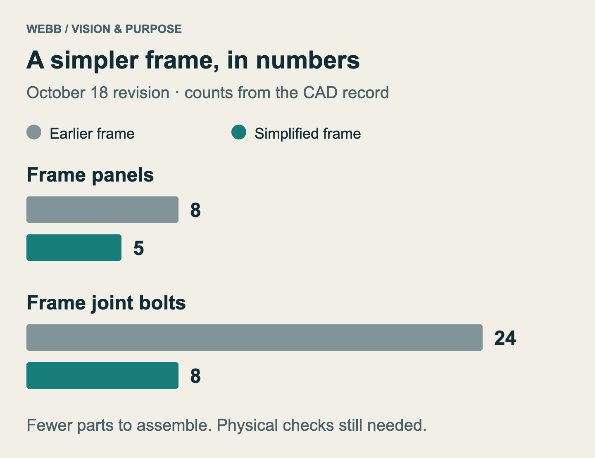

# Submarine ROV Club and Our Vision for Helping the Museum

*Club journal — October 26, 2026*

## Why we build

We learn engineering by building an underwater robot together. Our remotely operated vehicle (ROV) brings mechanical design, electronics, programming, and testing into one project.

Our goal is to build something useful, understand how it works, and share what we learn with the museum and its community.

**Real-world example — underwater exploration.** NOAA’s Deep Discoverer shows how an ROV can bring observation tools underwater. It is a professional research vehicle, separate from our club project. Photo: NOAA; public domain, via the [U.S. Fish & Wildlife Service](https://www.fws.gov/media/rov-deep-discoverer).

## What our design looks like

As of today, our clearest progress is in design and preparation for fabrication. The project includes CAD models, printable parts, frame cutting files, assembly instructions, and records of geometry checks. CAD means computer-aided design. It lets us inspect how parts fit together before committing material to a full build. These records describe a vehicle under development. Physical fit, reliable operation in water, and the ability to carry out a useful task still need to be demonstrated through testing.

The vehicle layout uses eight thruster positions. Four have horizontal shafts set diagonally, and four have vertical shafts. A thruster is the motor and propeller unit that produces force to move the vehicle. Arranging several units around a frame creates the possibility of controlling movement in different directions, but the arrangement is only one part of the problem. The motors, electronic controls, software, and actual thrust all have to work together. Our [eight-thruster layout notes](../../cad/eight-thruster-assembly-2026-10-17/READ-ME.txt) record the modeled positions and clearances without claiming that the complete vehicle has already been driven in water.

**Project design — eight-thruster layout, October 17.** This CAD view makes the arrangement described above visible. It records the modeled layout; it is not a photograph of a tested vehicle.

The frame work shows how our design has developed. An early chassis established the arrangement of the holders and the surrounding structure. A later assembly explored a frame made from aluminum panels with space for an electronics tube. The October 18 revision reduced that frame from eight panels to five and reduced the frame joint bolts from twenty-four to eight. It also gave the tube a clear upward removal path in the model. The [simplified assembly notes](../../cad/easy-assembly-2026-10-18/READ-ME.txt) explain those changes and their remaining physical checks. Making the vehicle easier to assemble and reach inside is a practical goal: we will need to inspect, adjust, and repair it as we learn.

**Project design — simplified assembly, October 18.** The open frame and tube straps show the intended access for assembly and maintenance. Tube protection and the full vehicle still require physical validation.

**Design graph — fewer frame parts and joints.** Both pairs use the same zero-based count scale. Values come from the [October 18 assembly notes](../../cad/easy-assembly-2026-10-18/READ-ME.txt); they measure design simplification, not strength or assembly time.

Much of the recent work has focused on a single thruster assembly. Its housing, motor attachment, fan, and removable cone have gone through several revisions. The October 25 smooth-frame revision removed obsolete crescent mounts and smoothed the outside of the housing while retaining the current working joints. The [assembly and print guide](../../cad/smooth-frame-r14-2026-10-25/ASSEMBLY-AND-PRINT.txt) includes small test pieces so that important fits can be checked before printing a complete replacement. The design checks support the shape and assembly clearances in the model; they do not establish real thrust, strength, or underwater durability. Earlier whole-vehicle snapshots also remain separate from these newer thruster revisions, so bringing the parts together is still an integration task.

**Project design — a closer look at one thruster.** The R14 model connects the discussion of housing, propeller, and removable cone to an actual saved design. This newer component revision still needs integration with the earlier whole-vehicle layout.

This kind of work is what the club does in concrete terms: take a design problem, inspect it closely, make a change, and record what that change establishes. Sometimes progress is a new part. Sometimes it is a simpler assembly or a better explanation of a limit. Removing a feature that no longer serves a purpose can be just as useful as adding one. Keeping a record helps us understand why a shape changed and prevents the next person from having to reconstruct the entire decision from a finished model.

## Bringing engineering into the museum

We want to help visitors discover how underwater robots work. A small display could combine CAD images, unpowered printed parts, and simple explanations of our design choices.

Visitors could compare two versions of a part or predict how thruster placement changes movement. Museum staff would help choose activities that suit their visitors and space.

**A possible museum display:** see the design, compare parts, and try an idea. The format would be developed with museum staff.

## A future window underwater

In time, a tested ROV could help the museum view or document underwater environments. A camera system remains a future idea. Any activity would depend on the museum’s needs and what the vehicle can reliably do.

## Turning the vision into evidence

Next, we need to check printed fits, assemble the parts, and test the controls before evaluating the vehicle in water. We will record the results in our [physical fit record](../../cad/thruster-final-optimization/physical-fit-record.csv).

**Our next steps:** move from CAD to physical testing, then use the results to guide museum activities. A small unpowered display could start sooner.

Success means building carefully, explaining what we learn, and making it useful to others.
