# Motor and fan CAD development journal

**Project:** WebbSubmarineROV  
**Journal date:** 26 October 2026  
**Coverage:** Recorded thruster revisions from 15–25 October 2026; retrospective compiled from the saved local design, assembly, verification and print-package records.

This journal follows the A2212-based thruster from a printed propeller and internal motor insert to the current combination of an R11 fan, the actual source motor and metal adapter, an R13 concave cone, and an R14 one-piece housing. The central engineering questions were how to locate the motor, transmit torque, retain the fan, maintain clearance, and make the assembly practical to print and put together.

Dates below come from dated instructions, revision records and plans, not filesystem modification times. Multiple revisions occurred on 25 October; their revision order establishes the sequence. The R7 directory is named 24 October, while its final engineering notes are dated 25 October. This retrospective records existing evidence; it does not claim that CAD checks or physical tests were rerun while writing it.

The most important physical feedback in the record is the original print's blade rubbing and tight spacer insertion on 17 October. Later documents repeatedly identify their results as CAD checks or fit-test prototypes. A saved version, an interference check, a closed STL, or a rotation animation is not a successful powered-water test.

## How to read the illustrations

Every stage below has its own saved image, with bold caption labels directing attention to the changed features. Figure numbers follow the revision sequence; **Figure 7 is R6.1**, so figure numbers and revision numbers are not interchangeable. The original images are preserved. CAD colors identify components or selections, not necessarily materials. Some Onshape document titles retain an older revision name; the saved revision tabs and linked records establish which version is shown.

Except for the explicitly labeled original-print contact sheet, these are CAD captures or design previews. They show arrangement and visible shape. Dimensions, hidden interfaces, clearance results and verification counts come from the adjacent source records. The separate diagrams are explanatory schematics, not manufacturing drawings or physical-test evidence. Click an image to inspect its original size.

## Revision map

| Date | Revision | Reason for the change | Main result |
|---|---|---|---|
| 15 Oct | PLA baseline | Make existing fastener access and retention practical | Washer seats, captured cover nuts, six fit pieces |
| 17 Oct | R2 | Respond to observed rubbing and tight spacer fit | 71 mm blade sweep, 22.6 mm insert, rear wire ring |
| 17 Oct | R3 | Help center the motor during installation | Integral tapered stationary motor guide |
| 17 Oct | R4 | Replace cover retention pins with clamped joints | Four M3x12 cover through-bolt joints |
| 21 Oct | R5 | Remove the rear wire holder | Ring and its added posts removed |
| 23 Oct | R6 | Eliminate the internal motor spacer | External bell clamp with two M3x16 bolts |
| 24 Oct | R6.1 | Reduce the rear boss projection | Flat, shorter motor-access boss |
| 24–25 Oct | R7 | Eliminate external clamp bolts | Printed compression collar and jam ring |
| 25 Oct | R8 | Move retention to the projecting shaft | Two printed jaws with opposed M3 bolts |
| 25 Oct | R9 | Follow the requested component layout | Forward fan and flat hub; bench preassembly |
| 25 Oct | R10 | Use a normal metal collet adapter | Flat fan hub, forward cap, separate duct extension |
| 25 Oct | R11 | Use the actual Onshape motor/adapter models | Correct adapter bore, hub thickness and motor screw depth |
| 25 Oct | R12 | Combine the frame and outer duct | One connected housing, removable cap |
| 25 Oct | R13 | Increase adapter clearance and simplify cap attachment | Concave cone and front-loaded M3x12 joints |
| 25 Oct | R14 | Remove obsolete mounts and smooth the exterior | Current smooth housing with R13 interfaces retained |

## 15 October — establish the PLA baseline

The earliest detailed thruster package in this collection concentrated on hardware access rather than redesigning the rotating assembly. The gray cover, propeller, motor insert and reference motor kept their geometry and placement. Four motor-base access pockets became 7.6 mm diameter with flat washer seats. Three cover bosses received washer recesses and AF5.8 captive-nut pockets.

The cover attachment was an important limitation: its three existing 4 mm holes were blind. The M3x8 bolts therefore acted as retention pins locked by nuts in the nozzle, with approximately 0.996 mm remaining before the hole floors. They did not form a through-bolted clamp. The motor base used four M3x8 screws with 0.5 mm washers; the propeller used four M3x8 screws into printed pilots in the internal insert.

Six small test pieces separated motor-hub fit, insert fit, M4 mounting, shaft passage, captive-nut fit and motor-base screw seating. Some retained actual mating geometry; others were nominal gauges. The baseline documented only about 0.55 mm conservative propeller-to-nozzle clearance. The unchanged 3.5 mm cover bore around the 3.175 mm reference shaft had just 0.1625 mm radial clearance.

The saved evidence records 35 CAD checks, a 39-solid assembly, a full-turn animation, and only four intentional screw-to-printed-pilot overlaps. Every entry in the physical fit sheet was still marked **NOT TESTED**. That distinction became consequential two days later.

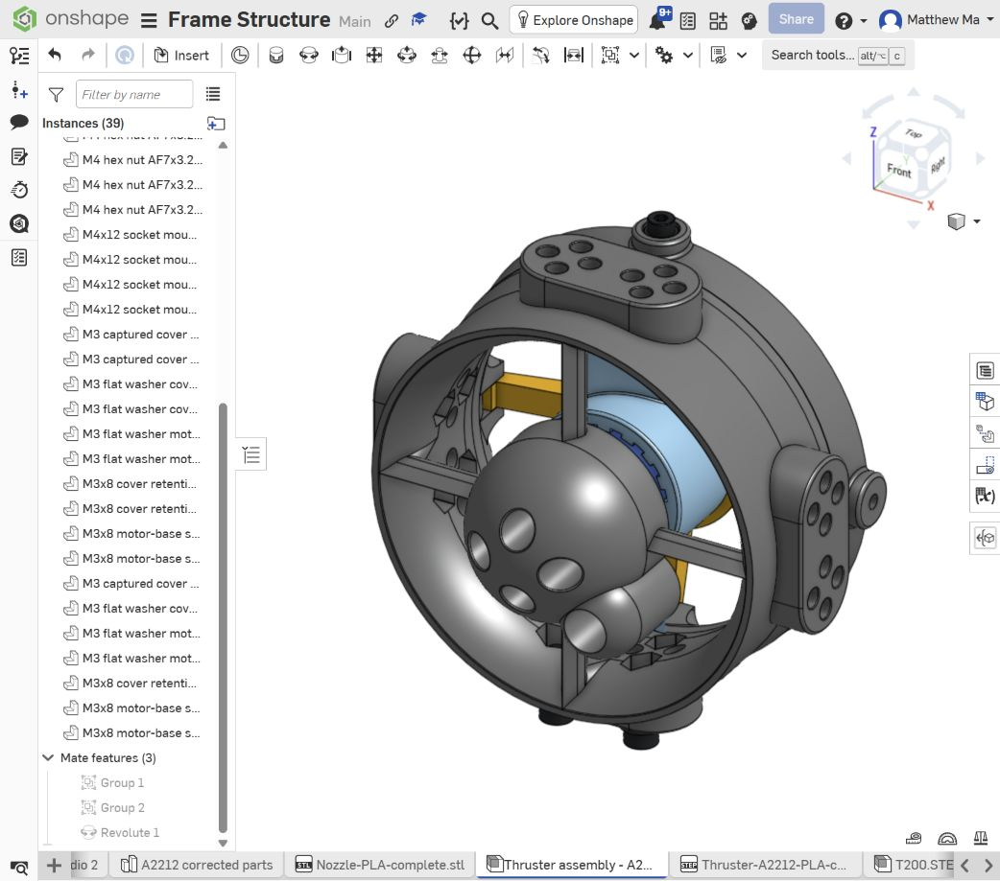

**Figure 1a.** The PLA baseline. **Foreground:** domed motor-access boss and single side wire collar. **Around the duct:** external mounting pads. The motor/fan assembly sits behind them. The recessed seats and blind-hole cover retention are described in the baseline instructions; this view does not expose their complete internal stack.

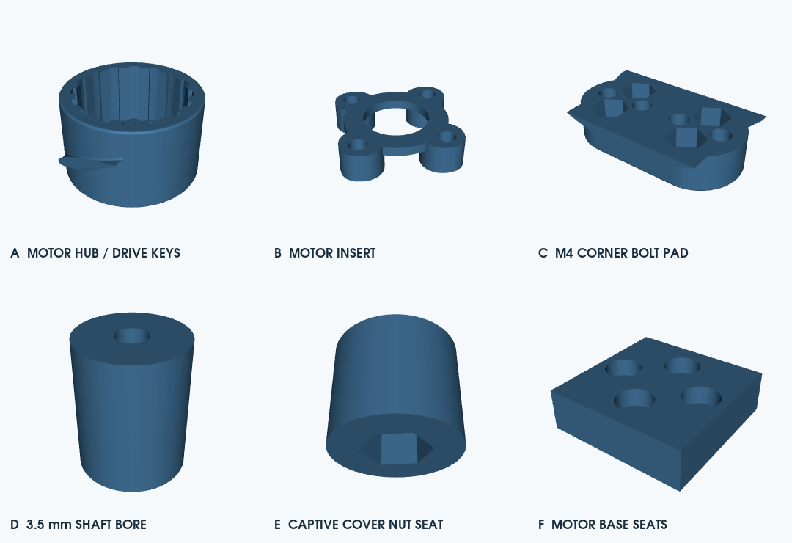

**Figure 1b.** The six fit pieces separate motor-hub/drive-key fit, insert fit, M4 mounting, shaft passage, captive cover-nut seating and motor-base screw seating. A–C retain native mating geometry; D–F are nominal gauges. These are CAD preparations for testing, not passed physical tests.

Sources: [baseline instructions](../../cad/thruster-final-optimization/START-HERE-P1S-PLA.txt), [verification scope](../../cad/thruster-final-optimization/CAD-verification-notes.txt), [physical fit record](../../cad/thruster-final-optimization/physical-fit-record.csv).

## 17 October — R2 responds to the printed parts

The physical record marks two original-print checks as failed: blade rub, supported by user video/photos, and rough, tight spacer insertion reported by the user. The photographs showed rough material inside the duct; they could not establish whether motor tilt or uneven hub seating also contributed. The revision therefore increased geometric allowance without pretending to diagnose every cause from an image.

R2 reduced the complete blade sweep to **71 mm** by trimming and rounding the tips. The hub, guide, drive keys and screw seats stayed unchanged. Conservative nominal tip clearance increased from about **0.55 to 2.45 mm per side**. The insert's outside envelope reduced from **23.2 to 22.6 mm**, removing 0.3 mm radially at its tips; its thickness, 18 mm screw pitch circle and four M3 pilots remained. No real motor inside diameter had been supplied, so the smaller insert was explicitly a print-first fit check.

The nozzle also changed from a single side wire collar to a centered rear ring: 66 mm OD, 56 mm ID and 6 mm thickness, supported by four 5 mm posts. Around the central 31 mm pod, this left a nominal 12.5 mm annular wire window. The ring guided routing but did not secure a moving cable by itself.

R2's clearance study included assumed eccentricity, print error, blade growth and tilt. Those values were design allowances, not measurements of the user's print. The revised parts remained physically untested in the saved status sheet.

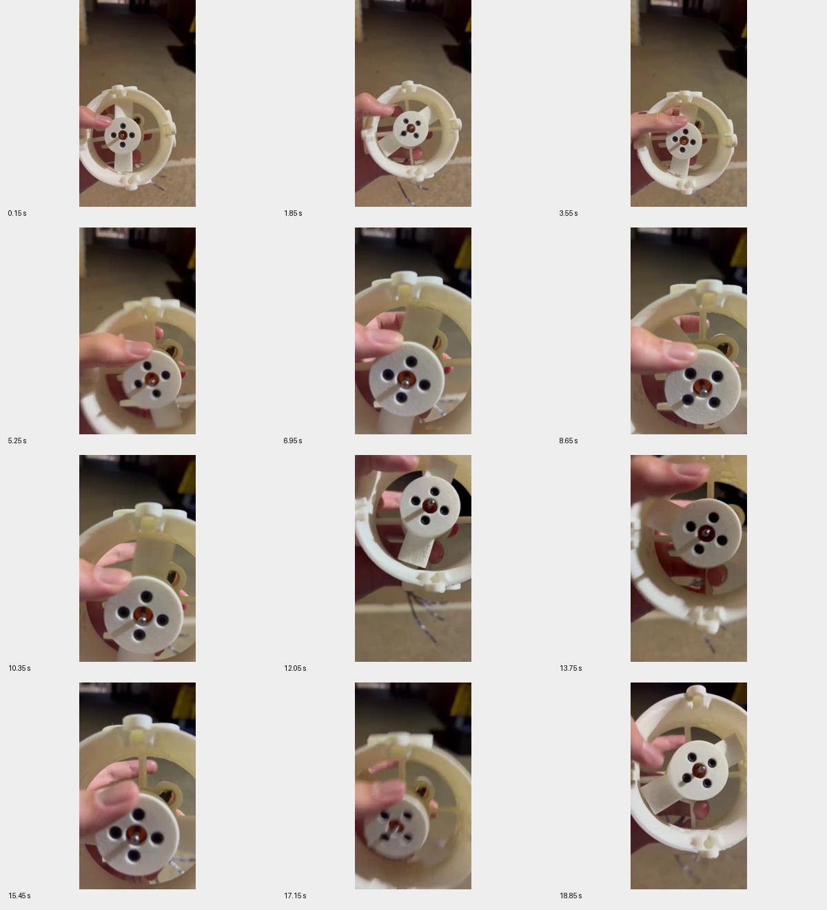

**Figure 2a.** **Original-print evidence, before R2.** The contact sheet shows the fan being turned by hand. The accompanying physical-test record reports blade rubbing and tight spacer insertion. These are not photographs of a successful R2 test; the stills do not establish motor tilt or measure the clearance.

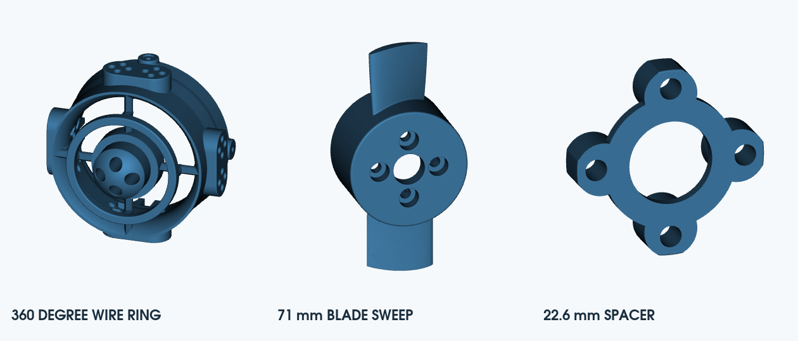

**Figure 2b.** R2’s three replacement prints: the nozzle with an annular rear wire guide, the fan labeled with its **71 mm** blade sweep, and the insert labeled **22.6 mm**. The labels are nominal design dimensions, not measurements of a new print. Compare the ring with the baseline’s single side collar in Figure 1a.

Sources: [R2 instructions](../../cad/print-revision-2026-10-17/READ-ME-BEFORE-PRINTING.txt), [physical test status](../../cad/print-revision-2026-10-17/physical-test-status.csv).

## 17 October — R3 guides the stationary motor base

R3 added an integral centering cup to the nozzle so the motor base could enter a taper before its four screws were aligned. It addressed installation guidance without changing the rotor, fan, spacer or original front cover.

The cup had a **37 mm outside diameter**, **28.5 mm locator throat** and **33.5 mm entrance**. Four rounded windows between its support sectors provided cable and water passages. The mounting screws still supplied the motor's final location and retention: the cup was an assembly aid, not a shaft bearing or waterproof seal.

The recorded 34 native-geometry and mesh checks included a 3.25 mm gap to the rotating hub, approximately 3.106 mm to the bell envelope, and passage of four 9 × 2.6 mm cable-bundle gauges. The nominal blade clearance remained about 2.45 mm. R3 had not yet been printed on or tested against the actual motor, and the early reference stator omitted real windings and lead details.

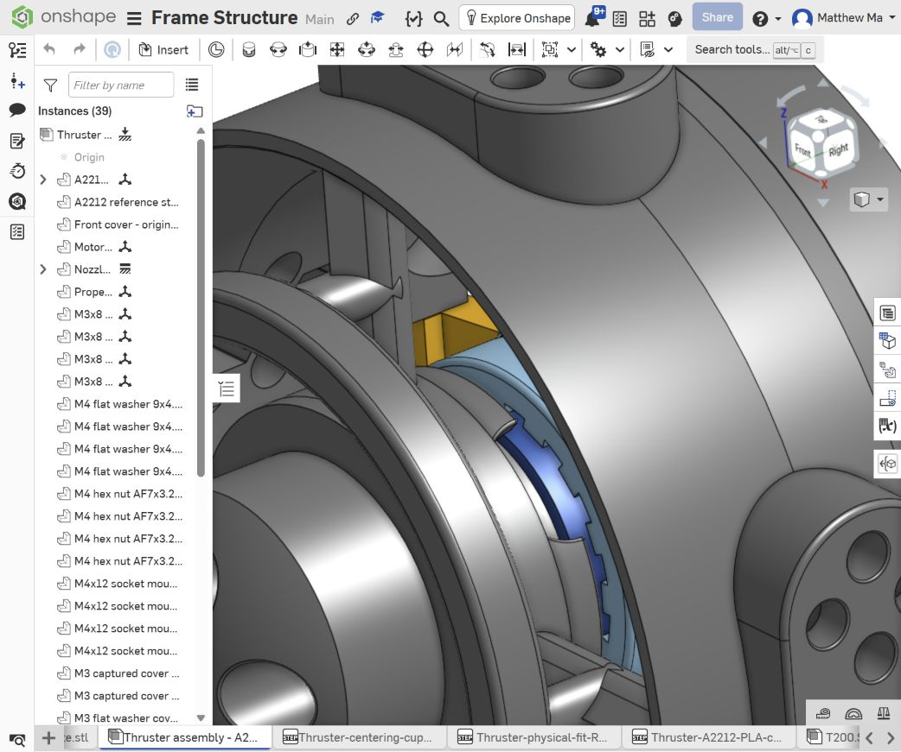

**Figure 3.** **Behind the rear ring:** fixed guide sectors surround the motor reference, with openings between them for cable routes. The ring partly obscures the cup, so this view does not show all four windows at once. The cup helps center the motor during installation; it is not a shaft bearing or seal.

Source: [R3 centering-cup instructions](../../cad/motor-centering-cover-2026-10-17/READ-ME-CENTERING-CUP.txt).

## 17 October — R4 makes the cover a through-bolted joint

R4 replaced the earlier pin-style cover retention with four complete clamped joints. This required printing the nozzle and front cover together because their mating tabs changed. The 71 mm fan, 22.6 mm insert, motor-centering cup and rear wire ring carried forward.

Each joint used an **M3x12 screw, two 0.5 mm flat washers and an M3 nut**. The modeled stack comprised a 5 mm cover tab, 3 mm nozzle seat, both washers and a 2.4 mm nut, leaving 0.6 mm nominal screw projection. The 3.4 mm clearance holes and AF5.9 nut pockets avoided relying on printed threads. Nut and washer loading slots, flat bearing faces and Allen-key access were checked as part of the joint design.

The assembly grew to 46 bodies. Thirty independent checks and native rotation evidence supported approximately 2.4495 mm blade-to-nozzle clearance and 1 mm to the front cover. The four screw-to-insert pilot contacts remained intentional. The record explicitly says that this R4 revision had not been physically printed or tested.

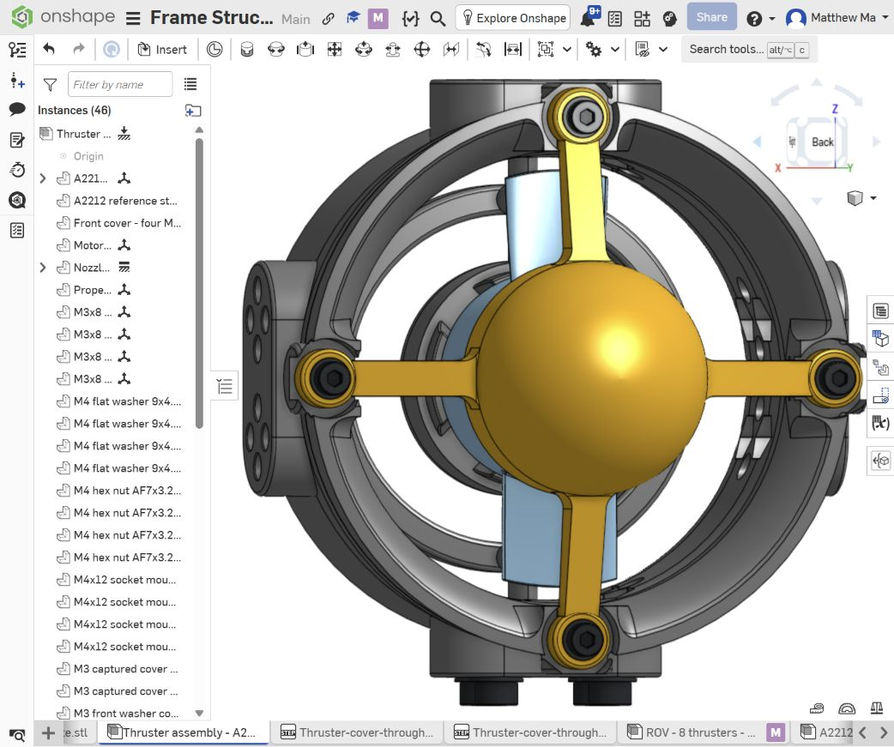

**Figure 4.** **At the four arm ends:** socket-head screws and front washers attach the cover to the nozzle. The rear washer/nut loading arrangement is hidden from this angle and is explained in the schematic below. The gold cover is a CAD display color, not a metal material specification.

**R4 joint schematic — not to scale.** Read downward along one M3x12 screw, from its head toward its tip. Dimensions come from the R4 instructions; all four cover joints use this stack. This historical R4 stack must not be substituted for the later R13/R14 joint.

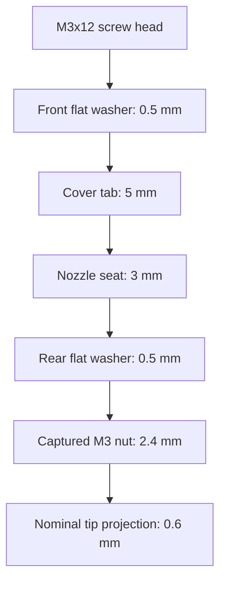

The nominal stack below the head totals 12 mm: 0.5 + 5 + 3 + 0.5 + 2.4 + 0.6. The washers distribute clamping load; the real captured nut supplies the threads.

Source: [R4 through-bolt instructions](../../cad/cover-through-bolts-2026-10-17/READ-ME-THROUGH-BOLTS.txt).

## 21 October — R5 removes the rear wire holder

R5 was a focused nozzle edit: remove the rear annular holder and its four added support posts while retaining the motor supports, centering cup, cover joints and external mounting pads. The file replaced only the R4 nozzle. The R4 cover, R2 fan and insert, hardware and assembly positions were retained.

The saved 12-check result reports unchanged material outside the removed regions, a closed connected nozzle mesh, and preserved full-turn clearance. No successful cable-management or water-flow experiment is recorded as the reason for this removal; the evidence supports the requested geometry change, not a measured performance improvement. Real wires still needed secure routing away from the rotating parts.

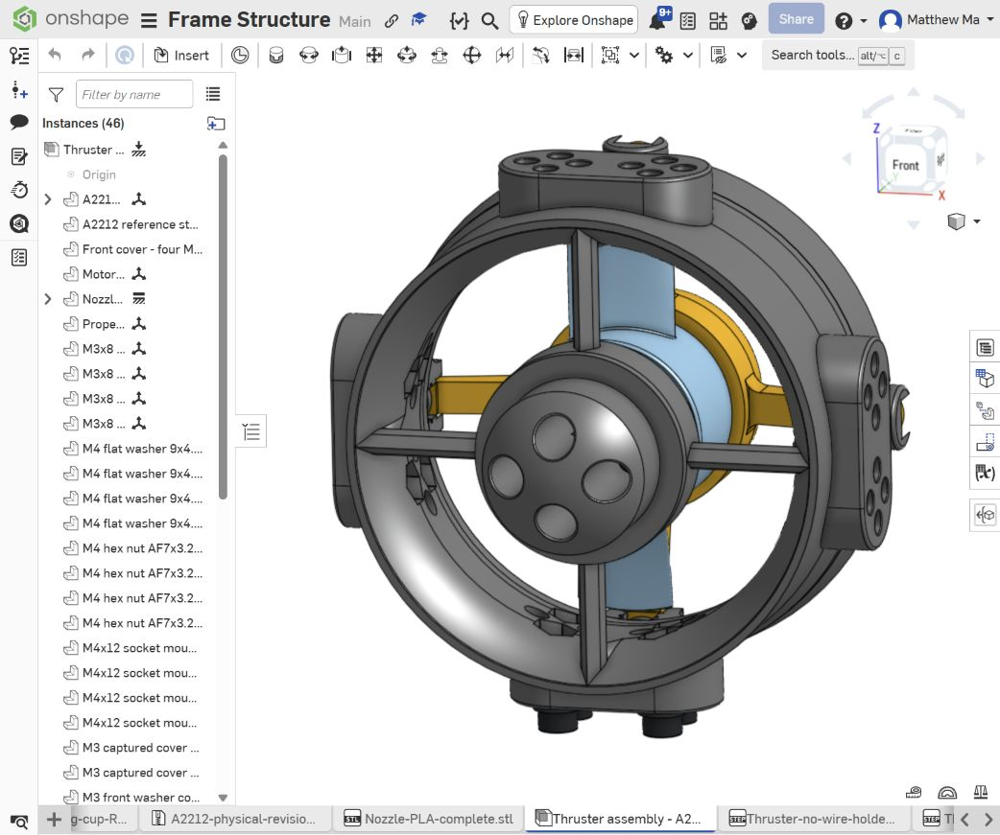

**Figure 5.** **Around the domed rear boss:** the annular wire holder and its added posts are gone. Original motor-support ribs, the duct and external pads remain. Compare this open region with the ring in Figures 2b and 3. The small outer crescent features are separate geometry; R5 did not remove those.

Source: [R5 removal record](../../cad/remove-wire-holder-2026-10-21/READ-ME-R5.txt).

## 23 October — R6 removes the internal spacer

R6 changed the fan attachment fundamentally. The old internal insert and its four propeller screws disappeared. A one-piece fan and external clamp slipped over the outside of the motor bell. Four solid keys carried torque through the reference motor's face openings; two opposed M3x16 bolt/nut/washer stacks provided axial retention.

The clamp bore was **28.0 mm** for the **27.7 mm** reference bell, giving 0.15 mm radial clearance. Its four 5.5 mm keys fitted nominal 6 mm openings on an 18 mm pitch circle. Relief at the key roots provided 0.2 mm motor-end clearance. The 0.6 mm stop gaps limited ear travel; they were not instructions to force the clamp fully closed. No tightening torque or grip strength had been measured.

R6 retained the R5 frame and R4 cap byte-for-byte in the supplied STLs. The record lists 29 checks, 47 total bodies, no native interferences and a 360-degree animation with an eight-part rotating group. This established a testable spacer-free mechanism, not proven retention at operating speed.

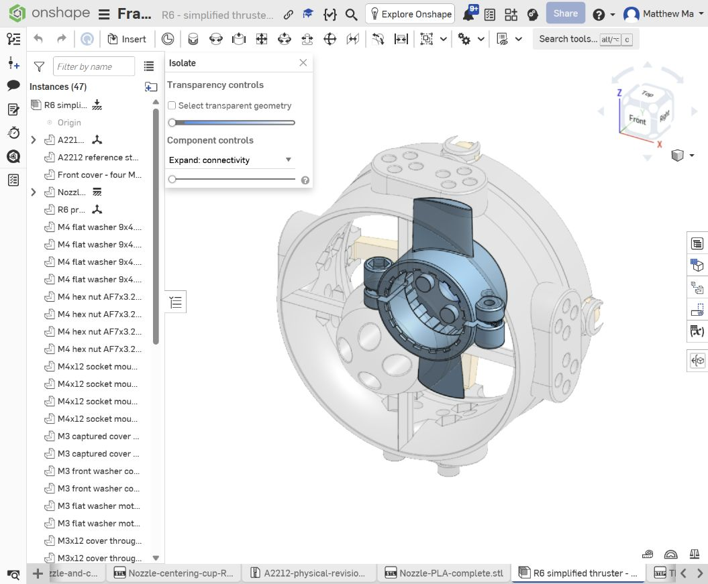

**Figure 6.** The fan is isolated while surrounding parts are ghosted. **Center:** a cup fits around the outside of the motor bell, with the drive-key region visible inside. **Opposite sides:** two bolt ears provide clamp retention. The 23 October R6 design is shown in an inspection capture dated 24 October; the image date does not make this R6.1.

**R6 functional diagram — not to scale.** Torque transmission and axial retention have different jobs. Arrows describe the intended function, not measured load capacity.

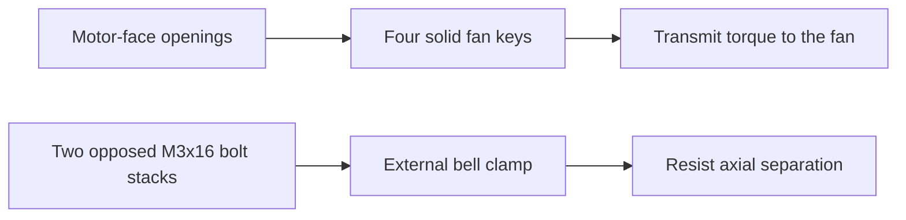

Sources: [R6 assembly and fit limits](../../cad/spacer-free-design-2026-10-23/READ-ME-R6.txt), [R6 status](../../cad/spacer-free-design-2026-10-23/design-status.json).

## 24 October — R6.1 flattens the rear boss

R6.1 shortened the rear motor-access dome by about **12 mm**, placing its flat end at Y = −30 mm while retaining 7 mm behind the central blind pocket. It preserved the motor seat, four 7.6 mm access holes, centering cup, fan and hardware. This was a local shape change; the motor did not move.

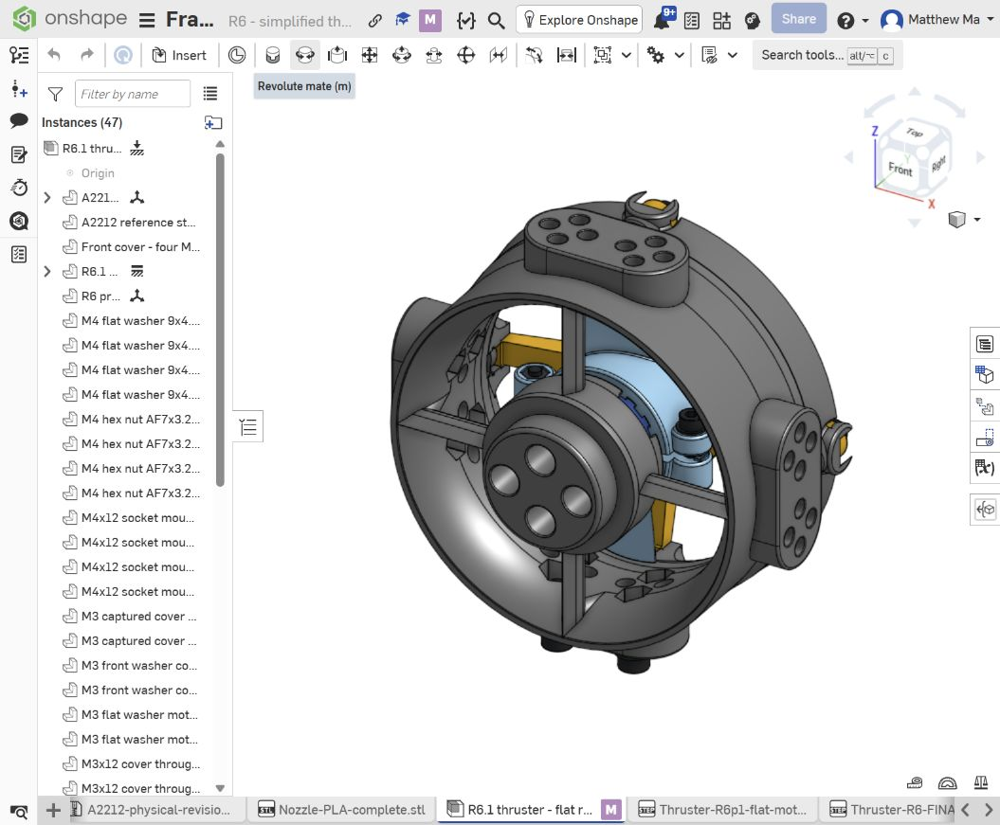

**Figure 7.** **Center:** the projecting dome becomes a flat circular access face while the four access holes remain. R6’s clamp ears are still visible behind it. Compare the rear boss with the dome in Figure 5; the change shortens that feature without moving the motor. The approximately 12 mm reduction comes from the record, not a perspective measurement.

Source: [R6.1 rear-boss change](../../cad/flatter-motor-boss-2026-10-24/READ-ME-R6p1.txt).

## 24–25 October — R7 explores bolt-free external retention

R7 replaced the external bolt ears and six clamp hardware parts with a split sleeve, printed compression collar and counter-tightened jam ring. The four solid motor keys still transmitted torque; the sleeve gripped the bell to resist axial separation. The internal spacer region remained empty, and the frame and cap were preserved.

The design record is useful because it explains compromises. Preserving blade-root connections required a larger central sleeve. A rounded runout shoulder supported the last partial thread and limited travel. The shoulder's 41.7 mm diameter required a 43 mm checking envelope, replacing an abandoned 40 mm target. Increasing the ring OD to 46 mm retained roughly 2 mm minimum wall near its flutes and thread. Explicit radial thread sections replaced earlier sweep approaches that failed geometry checks.

Assembly order was corrected: the main collar had to go on first from the smaller rear sleeve end, followed by the jam ring. The coupling was to be tightened outside the frame before installing the motor/fan unit. The test coupon checked bore/thread fit only; its shorter connecting ring did not reproduce full-fan flexibility or grip strength.

The final record reports geometry, thread-travel, structural and mesh checks passing, with 43 assembly instances and no native interference. Printed thread feel, finger deflection, bell distortion, pull-off force, PLA creep and balance remained unmeasured. The move to R8 is not evidence that R7 failed a physical run.

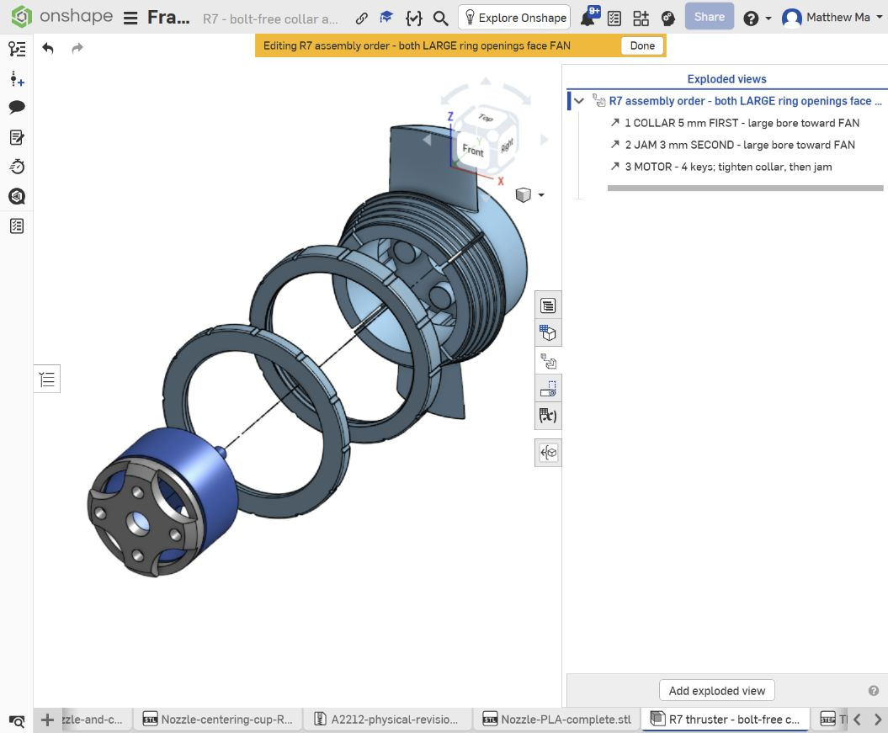

**Figure 8a.** The exploded guide separates the bell, two printed rings and threaded sleeve. Its corrected loading order is **main collar first, then jam ring**, with both larger openings toward the fan. Exploded spacing illustrates assembly and is not installed clearance.

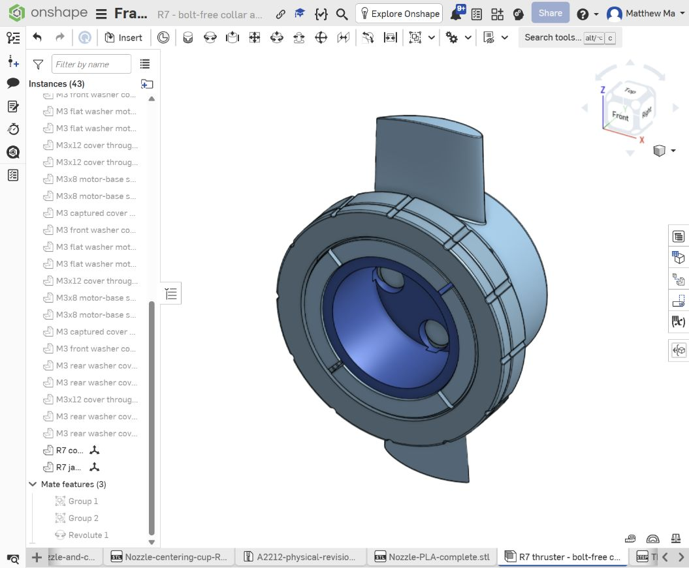

**Figure 8b.** **Around the sleeve:** two fluted rings replace R6’s external bolt ears. The keys carry torque, the compressed sleeve grips the bell axially, and the jam ring resists back-off. This is the proposed CAD mechanism, not a measured pull-off or creep result.

Sources: [R7 engineering decisions](../../cad/bolt-free-retention-2026-10-24/ENGINEERING-NOTES.txt), [R7 print/assembly instructions](../../cad/bolt-free-retention-2026-10-24/print/READ-ME.txt).

## 25 October — R8 moves retention to the axle

R8 replaced the printed collar arrangement with an integral lower shaft jaw and removable upper jaw. Two M3x16 screws, inserted from opposite sides, closed the jaws around the axle; the existing four motor-face keys continued to transmit torque. The frame, cap and blade geometry stayed in place.

The reference shaft was **3.175 mm**, the unloaded bore **3.30 mm**, and the available straight gripping length only **3.05 mm**. The nominal jaw gap was 0.30 mm, with approximately 0.125 mm geometric closing travel. That short grip was explicitly left as a physical retention-test requirement. A review also found that 6.8 mm access wells admitted nuts but blocked the assumed 8.4 mm nut driver. Increasing the wells to **8.6 mm** resolved the checked tool interference.

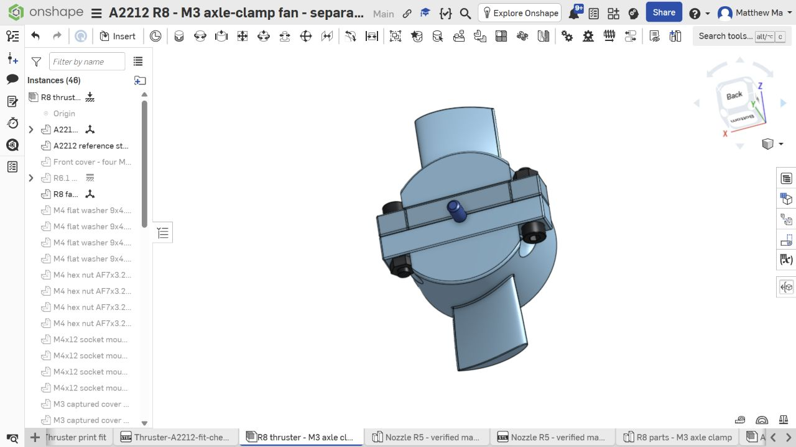

**Figure 9.** **Across the hub:** the printed jaw pair surrounds the projecting blue axle. The two screw heads enter from opposite sides. The frame and cap are hidden to reveal this mechanism. The short available grip and enlarged tool-access wells are documented in the linked records; retention strength remained untested.

Sources: [R8 dimensions and assembly](../../cad/shaft-clamp-r8-2026-10-25/ASSEMBLY-AND-PRINT.txt), [R8 tool-access correction](../../cad/shaft-clamp-r8-2026-10-25/FINAL-REVIEW.txt).

## 25 October — R9 reorganizes the fan around the sketch layout

R9 implemented the user's sketch order: fixed cap, rotating fan, motor and fixed rear motor support. It removed the deep fan cup around the bell, moved the outer blades **8 mm forward**, and joined them to a flat R20 hub with rounded roots. It preserved the outside blade profile beyond the modified root region.

The forward layout exposed another assembly issue: a long straight nut driver was obstructed by the installed frame. The solution was a documented bench sequence—clamp fan to motor outside the frame, then insert them together with the cap removed and motor-base screws withdrawn. A continuous insertion corridor checked that sequence geometrically. Dense mesh comparisons supported retained outer blade shape where legacy STEP comparisons were unreliable.

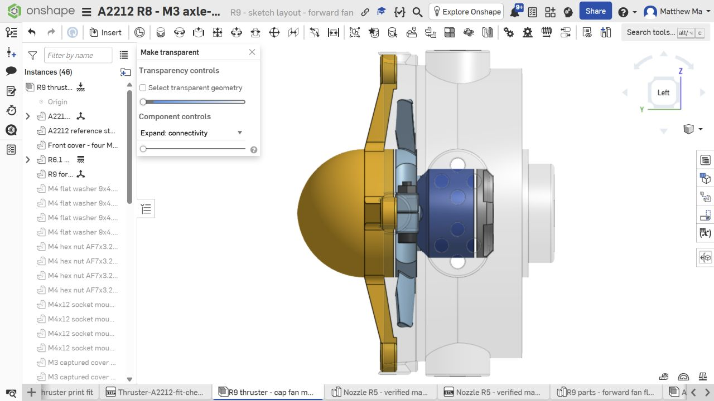

**Figure 10.** **Read left to right:** front cap → fan and clamp → motor → rear support. The surrounding structure is transparent to reveal this order. This is component position, not the installation sequence: the motor and fan must first be joined on the bench. The 8 mm movement comes from the design record.

Sources: [R9 layout](../../cad/sketch-layout-r9-2026-10-25/ASSEMBLY-AND-PRINT.txt), [R9 review and insertion correction](../../cad/sketch-layout-r9-2026-10-25/FINAL-REVIEW.txt).

## 25 October — R10 changes to a metal collet adapter

R10 abandoned the printed jaws, motor-vent keys, compression collar and jam ring in favor of a conventional metal collet propeller adapter. The archived design selected the CPA-317-N with a 3.17 mm motor input and M6 stud. This journal records that historical selection, not current supplier availability.

The new fan had a **6.2 mm clearance bore** through a **6.5 mm flat hub**, clamped between the metal backplate and washer. Accommodating the adapter moved the unchanged cap **28 mm forward** and introduced a separate 28 mm duct extension. Four M3x40 bolts replaced the shorter cap bolts; the instructions called out that those long screws were absent from the pictured 6–20 mm assortment.

Review identified two practical uncertainties. The supplier information did not establish usable collet bore depth, so the model allowed the entire adapter/fan stack to move 0–3 mm forward, while requiring real full shaft engagement and a measured seating datum. The extension's locating pocket also needed relief rather than nominally coincident mating surfaces; revised pockets and a larger rear mouth passed 24 lateral-offset probes.

The 45-solid assembly and continuous envelope checks supported clearance, including 3.63 mm minimum cap clearance across that installation range. They did not establish collet grip or justify partial shaft engagement. R10 remained a purchased-hardware fit prototype.

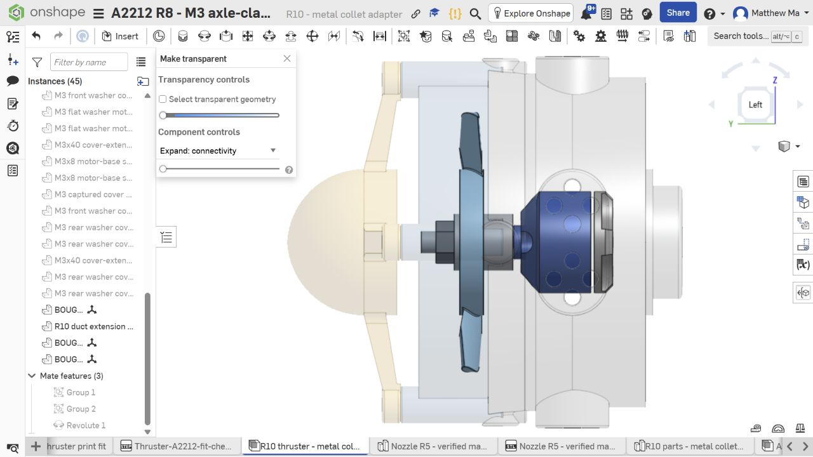

**Figure 11.** **On the fan axis:** a generic metal-collet reference replaces the printed jaws. **Around the assembly:** the transparent view reveals the forward cap and separate duct extension. This is R10’s clearance model, before the actual source motor and adapter were introduced in R11; it is not a manufacturer machining drawing.

Sources: [R10 design](../../cad/metal-collet-r10-2026-10-25/DESIGN.txt), [R10 assembly](../../cad/metal-collet-r10-2026-10-25/ASSEMBLY-AND-PRINT.txt), [R10 final review](../../cad/metal-collet-r10-2026-10-25/FINAL-REVIEW.txt).

## 25 October — R11 matches the actual Onshape motor and adapter

R11 corrected a consequential assumption: the user's actual source adapter was not the generic M6 envelope used by R10. Four native Derived references brought in the motor body, threaded collet, collar and bullet nut from saved Onshape sources without resizing or simplifying their geometry. The source motor was fused into one solid, so it stayed a fixed reference while the fan and three adapter pieces formed the rotating group.

The measured source gap between collar and bullet nut required a **7.14506 mm hub**, with a **5.1 mm stud clearance bore**. A **6.2 mm diameter × 0.35 mm deep** rear recess cleared the collar shoulder. The source male thread envelope was approximately 4.83 mm. This is why an R10 fan must not be substituted for the R11 fan simply because both use an A2212 motor description.

Using the real source also changed the motor-base hardware stack. The old screw tips would bottom approximately 0.1124 mm into the modeled blind-hole end. Adding a second 0.5 mm washer under each M3x8 head gave **2 mm engagement and 0.3876 mm blind-bottom margin**. Screw axes were recentered by less than 0.065 mm to match the actual holes; frame holes stayed unchanged.

The optional cross mount was omitted because it collided with the frame, which already supplied motor mounting. Three straight source wire solids were omitted because they were not routed flexible wires. Pre-existing shaft/collet and collet/collar overlaps were retained and reported as source clamping contacts, not erased to claim a globally interference-free motor assembly.

The recorded 29 geometry and seven assembly checks supported a 48-solid model, preserved source geometry and clear printed structure. Physical hardware matching, winding/wire behavior, grip and powered operation remained separate obligations.

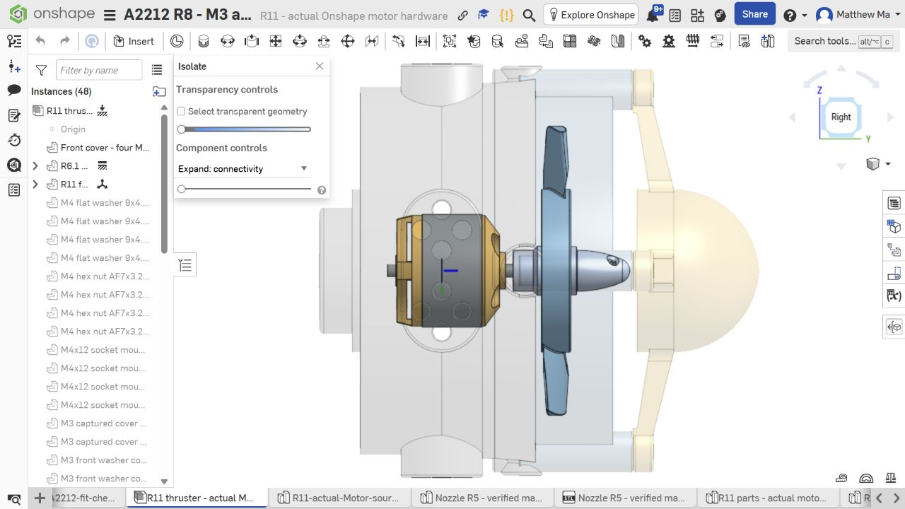

**Figure 12.** **Left:** actual source motor. **Center:** fan hub and adapter. **Right, toward the cap:** the distinctive bullet nut. This view faces the opposite direction from Figures 10 and 11; it does not show a reversed assembly or thrust direction. The measured hub and screw-depth corrections come from the source-model records.

Sources: [R11 design and measured interfaces](../../cad/actual-onshape-motor-r11-2026-10-25/DESIGN.txt), [R11 instructions](../../cad/actual-onshape-motor-r11-2026-10-25/ASSEMBLY-AND-PRINT.txt), [R11 provenance and corrections](../../cad/actual-onshape-motor-r11-2026-10-25/progress.md).

## 25 October — R12 combines the frame and duct

R12 merged the gray main frame and blue outer extension into one printable housing. The fan remained separate for rotation; the cap remained detachable for installing the motor/fan assembly. A simple union would have left the old mating-seam pockets, so a continuous annular web replaced that seam outside the rotating envelope, adding approximately 2,512 mm³ of material.

Installed external dimensions and retained hardware positions stayed the same. The assembly reduced from 48 to 47 solids, with 43 fixed and four rotating. The housing print footprint was approximately 101.59 mm square and its height 77 mm. Combining pieces removed one alignment joint but created a larger supported print, with the outer rim and spokes beginning above the build plate when the rear boss faced down.

Independent checks recorded 3.23 mm continuous rotation clearance to the housing and a clear insertion corridor for the five motor/fan/adapter bodies. The printable mesh was one closed connected component. Two microscopic export fragments were removed without resampling the functional surface. Legacy STEP reader faults remained disclosed; the packaged route relied on native Onshape geometry and verified STLs, not a claim of universally valid STEP interchange.

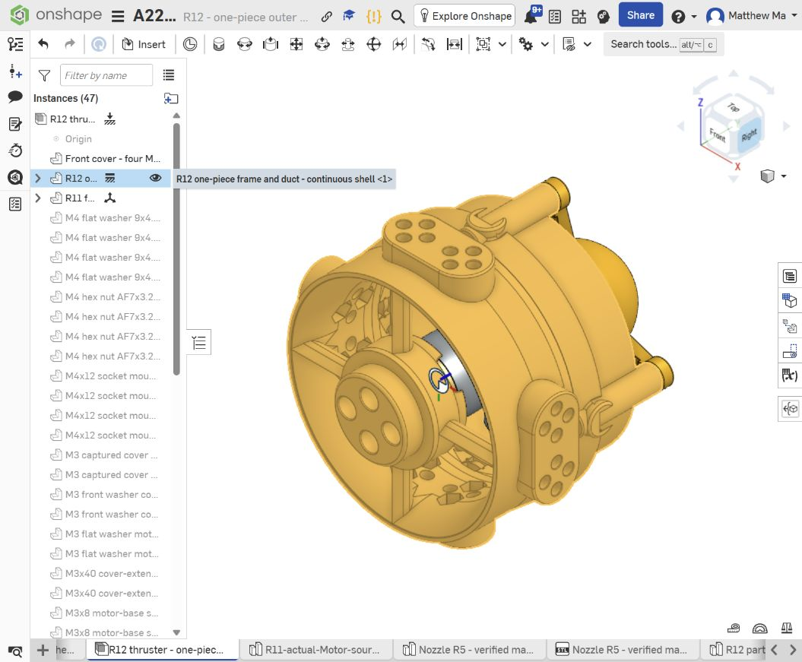

**Figure 13.** **Highlighted component:** main frame and outer duct are combined into one housing. The selected instance and “one-piece frame and duct” label identify the merged part. The fan and removable cap remain separate. Gold is the selection highlight, not the housing material; mesh connectivity comes from the verification report.

Sources: [R12 design](../../cad/one-piece-housing-r12-2026-10-25/DESIGN.txt), [R12 assembly and print guide](../../cad/one-piece-housing-r12-2026-10-25/ASSEMBLY-AND-PRINT.txt), [R12 review](../../cad/one-piece-housing-r12-2026-10-25/FINAL-REVIEW.txt).

## 25 October — R13 creates the concave cone and accessible short-bolt joints

The actual bullet nut made the cap's internal clearance a useful next target. R13 filled the obsolete blind 3.5 mm central passage and cut a smooth spherical bowl into the cap's flat inner face: nominally **24 mm mouth width, 8 mm depth and 0.6 mm rim rounding**. The exterior nose profile remained. The conservative metal-adapter clearance increased from approximately **1.77 to 6.09 mm**.

R13 also replaced four M3x40 cap screws with **M3x12 screws** and moved the captive nuts and rear washers to front-access seats. A nut/washer stack could now slide inward from outside each housing post. The modeled joint retained 2.4 mm nut engagement and 0.9 mm tip projection, with 2.7 mm of housing bearing roof.

Four 6.4 mm locating pilots, 0.8 mm high, mated to 6.8 mm × 1 mm cap recesses. Nominal radial and axial relief were 0.2 mm, with local 3.6 mm bolt bores. The paired housing and cone had to be replaced together; old M3x40 screws were unsuitable for the new front nut seats. Small actual-geometry joint coupons made that fit test cheaper than two full prints.

The 47-solid count and R11 fan/metal geometry remained. The record reports 21 geometry and five assembly checks, clear insertion/loading studies and closed print meshes. It also notes limited independent regression coverage of pilot endpoints and individual bearing-seat areas. That was a test-coverage limitation, not an observed R13 dimensional defect.

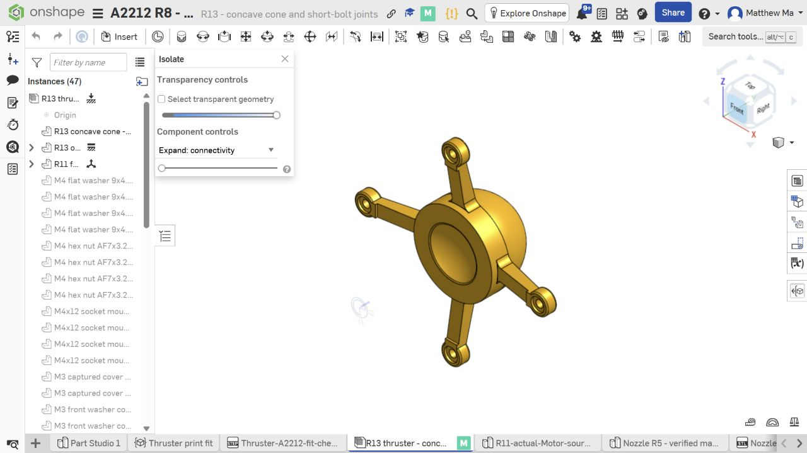

**Figure 14a.** **Inside the cone:** the broad concave bowl provides space for the adapter. Four attachment arms surround it. The adapter is absent in this isolated view, so the 6.09 mm modeled clearance cannot be read from the picture; it comes from the saved check.

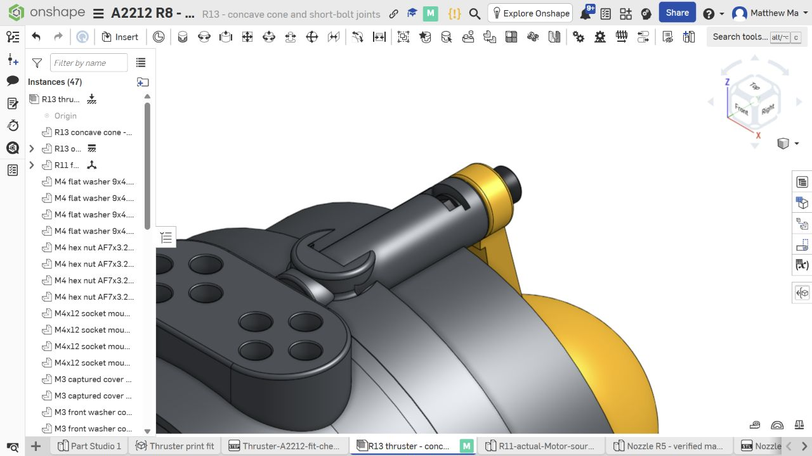

**Figure 14b.** **Beside the gold cone arm:** the front attachment region. **Nearer the housing:** a prominent older crescent is still present in R13; it is unused geometry removed in R14. Do not confuse that crescent with the new working nut seat. Screw length and hidden seat positions are given in the assembly guide.

Sources: [R13 design](../../cad/concave-cap-r13-2026-10-25/DESIGN.txt), [R13 matched-part instructions](../../cad/concave-cap-r13-2026-10-25/ASSEMBLY-AND-PRINT.txt), [R13 review limits](../../cad/concave-cap-r13-2026-10-25/FINAL-REVIEW.txt).

## 25 October — R14 removes obsolete mounts and smooths the housing

R14 is the latest revision found in the saved records. It removed four obsolete crescent-shaped mounts and filled their unused recesses. A gradual quintic curved transition replaced the stepped frame-to-extension exterior. The profile was designed to meet the end cylinders with continuous tangent and curvature; four working cap-bolt posts retained R5 rounded roots and 0.6 mm blends.

This was a housing-only edit. Working front nut seats, washer paths, bearing roofs, pilots and bolt access remained. The R13 cone and R11 fan printable files were byte-identical to their earlier verified files. The other 46 bodies had consistent bounds, volume and area signatures; the final review correctly stops short of calling those signatures an independent proof of exact geometric identity.

The record reports **five cleanup checks and 21 interface checks passing**, with clear continuous insertion and all four nut/washer loading paths. Modeled clearance remained **3.23 mm to the housing and 6.09 mm to the cone**. The new housing STL contained 511,952 triangles, one closed manifold component, and a 0.02334% volume difference from native Onshape mass properties. Its print dimensions were approximately 101.59 × 101.59 × 77.8 mm.

Native interference evidence covered the housing, fan and cone. It was not a native all-pairs certificate for all 47 solids; separate checks covered changed structure against hardware and verified assembly poses. The print package contains no certified interchange STEP deliverable.

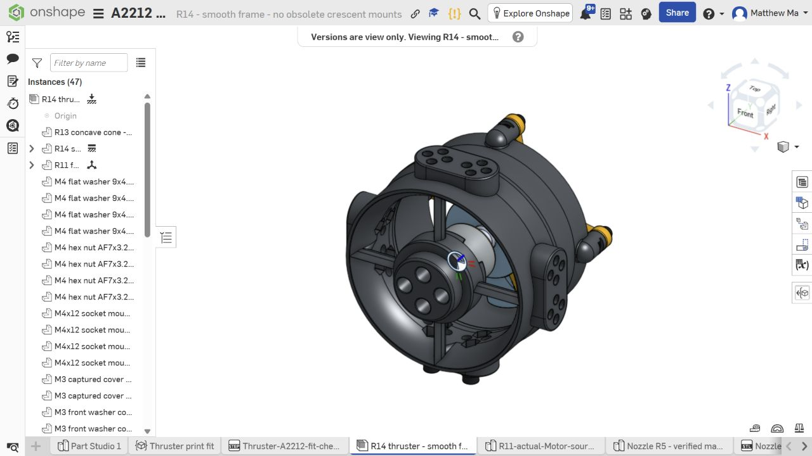

**Figure 15a.** Overall orientation of the saved R14 assembly: the updated housing surrounds the retained **R13 cone and R11 fan**, with the matching actual motor and metal adapter. A revision label applies to the changed housing; it does not mean every component was redesigned.

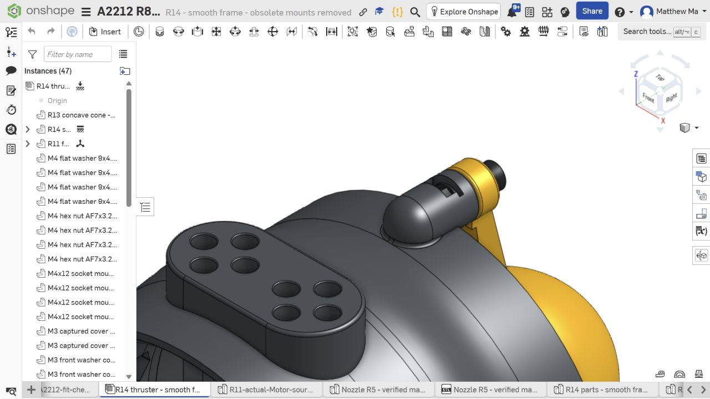

**Figure 15b.** **Post root:** the obsolete crescent visible in Figure 14b is gone and the remaining root is rounded. **Housing wall:** the stepped exterior becomes a gradual transition. The front joint beside the gold cone arm remains. The views have different framing; they show the shape change, not measured drag, strength or printed surface finish.

Sources: [R14 design](../../cad/smooth-frame-r14-2026-10-25/DESIGN.txt), [R14 assembly guide](../../cad/smooth-frame-r14-2026-10-25/ASSEMBLY-AND-PRINT.txt), [R14 final review](../../cad/smooth-frame-r14-2026-10-25/FINAL-REVIEW.txt), [print verification](../../cad/smooth-frame-r14-2026-10-25/print-verification.json).

## Current print starting point and remaining evidence

For a new print matching the latest recorded design, start with the [R14 print kit](../../archives/R14-Smooth-Frame-Print-Kit.zip) and its [assembly instructions](../../cad/smooth-frame-r14-2026-10-25/ASSEMBLY-AND-PRINT.txt). The intended combination is **R14 housing + R13 cone + R11 fan + the matching actual metal motor/adapter**. The internal motor insert and all earlier printed fan clamps are absent. A usable R11 fan and R13 cone can be reused; only the housing changed for R14.

**Current compatibility map.** These are the components combined in the latest saved design; arrows mean “included in the assembly,” not torque or force paths.

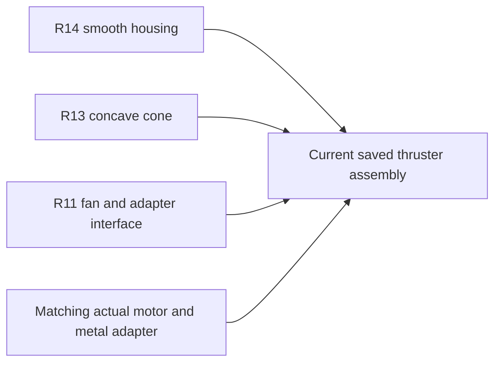

Print the R11 hub coupon first if the actual adapter fit is still unknown, and the housing/cone joint pair before committing to full replacement parts. The latest documented P1S/PLA starting setup uses a 0.4 mm nozzle, 0.12 mm layers for surface finish, five walls and six solid top/bottom layers, with solid motor/bolt bosses. These are starting settings, not a qualified manufacturing process. Use millimetres at 100% scale, inspect supports, and do not scale the whole part to correct a hole.

The current hardware distinction matters: four **M3x8 motor-base screws with two 0.5 mm flat washers per head**; four **M3x12 cone screws with front and rear flat washers and captured M3 nuts**; and the retained external M4 mounting sets. Follow the current assembly guide rather than borrowing a screw stack from an earlier revision.

The saved [package report](../../cad/smooth-frame-r14-2026-10-25/package-verification.json) records 24 ZIP entries, a valid CRC and source-byte agreement. That supports package provenance. It does not prove a print will fit the actual motor, that a hub will remain clamped after heating or reversal, or that the fan is balanced.

The next physical record should include measured adapter/coupon fit, joint loading and seating, motor-base screw depth, hand rotation with and without the cone, wire clearance, axial retention and any observed rub. A restrained low-speed test can then record vibration, current, loosening and behavior in the intended direction/reversal. Thrust, fatigue, creep, hydrodynamic performance, sealing and rated operating speed remain unqualified by the evidence reviewed here. The journal preserves the one documented original-print failure and the successive design responses without turning later CAD passes into invented successful hardware tests.
