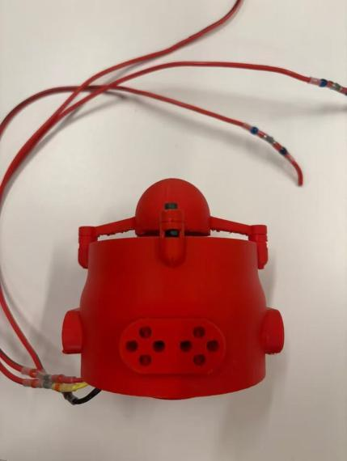
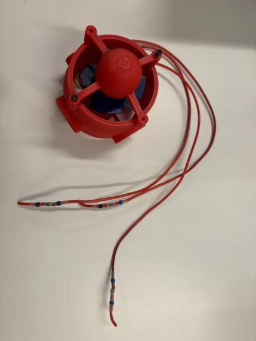
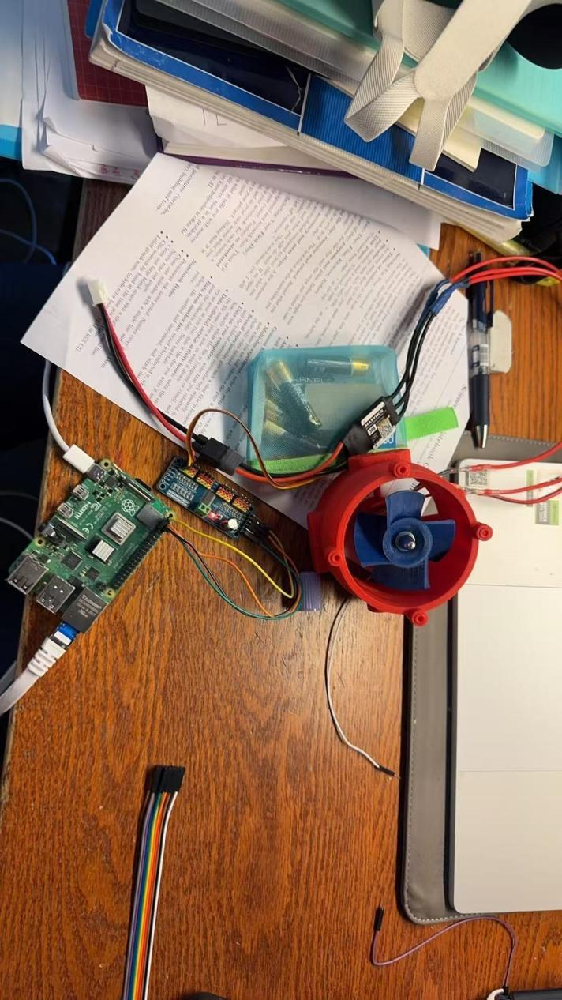

# Overall ROV project journal

Full webpage: https://matthewma11.github.io/WebbSubmarineROV/journals/overall-project-journal.html

**From the club’s nine-page journal.** The full written record is presented below as webpage text, with the original photos and connection diagram. Dates and experimental results are retained from the source; line breaks and minor typing errors have been cleaned up.

[Download original PDF ↓](../../downloads/rov-journal.pdf)[View source on GitHub ↗](https://github.com/MatthewMa11/WebbSubmarineROV/blob/main/downloads/rov-journal.pdf)

01 / EARLIER DEVELOPMENT

## DECEMBER 2023–MAY 2025 — Past documentation summary

This section summarizes the ROV project journal from December 2023 through May 2025. The record shows a progression from early subsystem concepts to fabrication and integration, with the design repeatedly revised in response to fit, sealing, cost, manufacturability, and space constraints.

## Methodology

- **Phased development:** The team defined five broad phases - research and initial CAD, early subsystem testing and iteration, full-system integration, final revision and optimization, and eventual launch/open-source documentation.

- **Subsystem decomposition:** Work was divided into the chassis and propulsion system, electronics pressure housing, camera dome, lighting, tether, manipulator/end effector, software, and control interface. Modules were designed and tested separately before integration.

- **Research-led decisions:** The team compared existing ROVs and underwater robotics practices, including Blue Robotics designs, Cornell CUAUV systems, BlueOS/ArduSub documentation, the Parker O-Ring Handbook, and advice from an Oceaneering engineer and an experienced former student.

- **Analysis before fabrication:** Fusion 360 and Onshape were used for parametric CAD, tolerance studies, assembly checks, static-stress/finite-element analysis, and pressure calculations for the camera dome. Parts were organized in a master assembly to expose collisions and packaging problems.

- **Rapid prototyping and evidence-based revision:** FDM printing, fit checks, dry assembly, short underwater seal tests, and component-level trials were used to identify defects. Dimensions, print orientation, supports, materials, and mechanisms were then revised before another print or build.

## Key progress

- **Chassis and propulsion:** The team developed a compact, modular plate-and-cage chassis with vectored horizontal thrusters and vertical thrusters for six-degree-of-freedom motion. The layout evolved to reduce blocked water flow, improve forward thrust, protect add-ons, and simplify maintenance. Six-millimeter polycarbonate plates were ordered and assembled.

- **Thrusters and propellers:** Brushless-motor housings were repeatedly refined with thinner fins, heat-set inserts, better motor offsets, and smaller propeller diameters. Custom clockwise and counterclockwise propellers were designed from airfoil and blade-pitch research, then printed and evaluated. By spring 2025, the brushless-motor wiring had been completed.

- **Electronics and pressure housing:** The acrylic electronics tube gained removable endcaps, an internal tray, separate battery packaging, connector space, and modular mounting. After several seal iterations, the team moved toward standards-based O-ring geometry, custom-length O-rings, lead-ins, grease, tighter measured tolerances, and epoxy-sealed wire penetrations.

- **Camera and lighting:** A pan-tilt camera module was redesigned from a large dome that obstructed two thrusters into a compact 4.5-inch package. A pressure check, mounting plate, clamp ring, and O-ring seal were developed, and the module was mounted to the frame in January 2025. Waterproof LED housings used epoxy potting; late-stage work included a custom right-angle mini-USB cable.

- **Manipulator:** The original multi-joint arm concept was progressively simplified after research showed that reliable underwater rotary actuation would be costly and difficult to maintain. Work shifted toward a compact, serviceable claw using a sealed linear/pneumatic-style actuator, an N20 gearmotor, and a printed slot-and-linkage gripper. Parts were purchased, measured, modeled, and printed for assembly.

- **Software and control:** The proposed stack used QGroundControl on the operator computer, a Raspberry Pi companion computer, ArduSub firmware, and BlueOS as the base interface. The team researched Pixhawk-supported camera stabilization, arm control through a Pololu Maestro servo controller, and a tether attachment designed to protect both the cable and vehicle.

## Past challenges and design responses

- Waterproof sealing was the dominant technical challenge. Early endcaps either compressed the O-rings so much that insertion was difficult or held them too loosely, allowing displacement and leakage. A roughly two-foot-deep, 20-minute test produced internal condensation. The response was to consult an expert, adopt Parker handbook guidance, revise groove geometry and lead-ins, use custom O-ring stock and grease, and reprint the caps with measured rather than nominal tube dimensions. In March 2025, the groove was narrowed by 0.75 mm and cap diameter reduced by 1.5 mm after checking the real tube.

- Integration exposed major packaging conflicts. The first camera dome blocked two thrusters, the arm competed with the camera for front-of-vehicle space, and the first electronics tray left too little room for wiring. The team responded by shrinking and inverting the camera turret, reconsidering manipulator placement, separating battery packaging, and redesigning the tray and master assembly.

- Underwater actuation created a cost-versus-reliability tradeoff. Field-oriented-control motors and commercial waterproof servos were technically attractive but pushed the arm toward an estimated cost of roughly $850 and still raised seal and corrosion concerns. The team reduced the manipulator's degrees of freedom and relied more on the ROV's own six-axis motion for positioning.

- Fabrication quality repeatedly limited progress. Ender 3 prints suffered from failed jobs, stringing, weak overhangs, and propeller trailing-edge defects. The team moved critical prints to a Bambu X1C, developed custom dense supports for the camera clamp, tuned PETG for sealing components, revised parts to reduce overhangs, strengthened layer orientation, and used repeated tolerance prints.

- Schedule and coordination slowed integration. Much of the early period was spent on CAD and isolated prototypes, while software, internal wiring, epoxy sealing, and full-system testing remained late-stage tasks. A spring 2025 planning meeting reset responsibilities and prioritized ordering, assembly, wiring, waterproofing, and an in-water test.

## MAY 2025 — Status at the end of the record

By May 2025, the journal documents a largely designed and substantially fabricated ROV entering final integration. The chassis, propulsion layout, electronics enclosure parts, camera module, lighting, and gripper components had all advanced through multiple prototype cycles. The final entries record direct wiring from the electronics enclosure to the motors and two LEDs; two additional LEDs were omitted because there were not enough LED drivers. The journal does not document a completed full-depth or final pool-validation test, so the clearest handoff point is an assembled, partially wired system still requiring final sealing, software integration, buoyancy checks, and comprehensive in-water verification.

02 / THE CAD & HARDWARE JOURNAL

## OCTOBER 15–26 — Webb Submarine ROV journal

Our club is building a remotely operated underwater vehicle to help the museum look for fossils. We plan to use lights to illuminate the search area, cameras to let the operator see and record possible finds, and a robotic arm to inspect or retrieve selected specimens under the museum’s guidance. This month’s work focused on making the frame easier to service and developing a thruster we can assemble and test.

## OCTOBER 15 — Establishing a print baseline

We started with a PLA thruster design built around an A2212 motor. The first changes were about access. We enlarged the motor screw pockets, added flat washer seats, and captured the nuts for the front cover. The cover’s holes were blind, so its screws acted as retaining pins. We prepared six small pieces to check individual fits before committing to another full print. The modeled blade-to-duct clearance was about 0.55mm per side, leaving little room for print variation.

## OCTOBER 17 — Blade rub and a tight insert

When the original printed fan was turned by hand, the blades rubbed the duct. The motor insert was also rough and difficult to seat. The photos showed rough material inside the duct, while the contribution of motor alignment and hub seating remained uncertain. For R2, we trimmed and rounded the blades to a 71mm sweep, increasing nominal clearance to about 2.45mm per side. We reduced the insert from 23.2 to 22.6mm across its widest points and added a rear wire guide. The new dimensions gave us another fit to check on the actual parts.

R3 added a tapered guide to help center the stationary motor base before fastening it. R4 replaced the front cover’s retaining pins with four M3 ×12mm through-bolts and captured nuts. The revised joint needed a matched cover and nozzle. The CAD checks gave us room to turn the fan and reach the fasteners. The revised parts still needed a physical fit check.

## OCTOBER 17–18 — Making the frame easier to service

The vehicle layout placed four thrusters diagonally in the horizontal plane and four vertically. On October 18, we simplified the aluminum frame from eight panels to five and reduced the frame joint bolt count from 24 to eight. The model also gave the electronics tube a clear path out through the top. That access matters when we need to work on wiring or remove the tube for inspection. This vehicle model predates the later thruster revisions, so we still need to check how the newer assembly fits the frame.

## OCTOBER 21–24 — Removing parts and revisiting retention

R5 removed the rear wire ring and its four posts. That simplified the nozzle, with wire routing still to be checked around the moving fan. R6 removed the internal motor insert and put the fan’s attachment around the outside of the motor bell. Four keys were designed to transmit torque, while two opposed M3 ×16mm bolts tightened the clamp to resist pull-off. R6.1 shortened the rear access boss by about 12mm while keeping the motor position and screw access.

## OCTOBER 24–25 — Finding a better way to mount the fan

R7 explored a printed compression collar and jam ring around the bell. R8 moved the clamp to the shaft, where the model showed only about 3mm of straight gripping length. R9 moved the fan forward and flattened its hub. A tool-access check showed that the installed frame blocked a straight nut driver, so we planned to assemble the fan and motor on the bench before sliding them into the housing.

R10 switched to a metal collet adapter and added a separate duct extension to make room for it. When we brought the actual motor and adapter models into Onshape for R11, their dimensions called for a different fan hub. We changed the hub to about 7.15mm thick with a 5.1mm bore. We also added a second 0.5 mm washer under each motor-base screw head to keep the screws from bottoming in the modeled blind holes. That check showed how much the assembly depended on the geometry of the actual hardware.

## OCTOBER 25 — Combining the duct and refining the housing

R12 combined the frame and duct extension into one printable housing and kept the cone removable. R13 recessed the inside of the cone to make room for the adapter nut. It also replaced the long cover bolts with four M3 ×12mm screws and moved the washer and nut seats forward so they could be loaded from the outside.

R14 removed four unused mounts and smoothed the housing transition while retaining the working cone joints. The current CAD assembly pairs the R14 housing with the R13 cone, R11 fan, and matching A2212 motor and metal adapter. The saved model showed 3.23mm clearance to the housing and 6.09mm to the cone. Those are CAD results. Printed fit, fan retention, vibration, thrust, and operation in water still need to be checked.

Printed thruster, rear view. Original journal photo, page 6.

Printed thruster, front view. Original journal photo, page 6.

03 / ELECTRONICS & MOTOR TESTS

## OCTOBER 29 — Raspberry Pi and computer communication

The communication between the PC and the Raspberry Pi 4 main board is maintained by mirroring a computer system into the micro sd card Raspberry Pi 4 carried using the Raspberry Pi imager. After mirroring, we tried to use the micro hdmi cable to project the Raspberry Pi 4 PC screen on the main PC. However, the wifi can’t be shared successfully, so we used the ethernet wire instead to maintain consistent wifi connection between the PC and the Raspberry Pi 4.

## OCTOBER 30 — Connecting the Pi, PCA9685, ESC, and motor

The October 30 entry records the connection between a Raspberry Pi 4, PCA9685, brushless ESC, and A2212 motor. The original diagram is included here, followed by the actual bench connection.

Connection diagram from the journal, page 7. I²C includes SDA and SCL. This records the team’s test setup.

The source notes that I²C includes SDA and SCL, and shows this photograph of the actual connection:

Actual motor-control connection photographed by the club. Original journal photo, page 8.

## OCTOBER 31–NOVEMBER 7 — Coding and getting the motor to spin

In the beginning, the code successfully passed compilation, but the motor is not spinning. Therefore, the communication between the PCA9685 and the Raspberry Pi 4 board and the communication between the esc and PCA9685 are all reviewed, making sure that the PCA9685 can export information from the plugged in pins and the esc can export data to the motor as well. However, after reviewing everything, the code is reimported and the motor is still not spinning.

Then, we reviewed the handbook of the esc and made the esc exerting pulse adjustable. Previously, we set the neutral pulse to be 1500 us; by making the esc pulse adjustable, the pulse can be raised to 1800 us max. As the pulse is increased to 1650 us, the motor starts to rotate at a low speed, the neutral pulse should be set to 1650 us.

**About this test result:** the journal reports that the motor began turning at 1,650 µs and calls this the “neutral” setting. Motion at that pulse is a recorded observation, not a verified stop/neutral calibration. The pulse values describe this experiment with the team’s particular hardware.

The source has a “Code” heading but contains no code listing.